# ⚡ DigitDNS

[](https://github.com/digitrob/DigitDNS/releases/latest)
[](https://github.com/digitrob/DigitDNS/actions/workflows/ci.yml)
[](https://github.com/digitrob/DigitDNS/actions/workflows/android.yml)
[](https://github.com/digitrob/DigitDNS/actions/workflows/docker.yml)
[](LICENSE)

DigitDNS is a self-hosted SmartDNS resolver, a TLS pass-through relay, a DNS sink
with ad blocking and a subscriber panel in one static binary. One install covers
DNS resolution, geo-blocking bypass and ad blocking. Point a phone, console, TV or
router at it and each domain gets one of three answers: resolve normally, refuse
or answer from the sink, or connect through your server. The panel manages rules,
subscribers, blocklists, certificates and upstream resolvers; a customer portal
and a native Android app give subscribers their own view.

**Looking for a self-hosted DNS server, a Pi-hole or AdGuard Home alternative
with ad blocking, or an SNI proxy for geo-restricted services?** DigitDNS
combines all three in one install, one panel and one Android companion.

It is a fork of [HyperDNS](https://github.com/IzumiRain/HyperDNS) by HyperRAIN,
maintained by [Digitrob](https://github.com/digitrob). It is free, open source
(AGPL-3.0), and runs on your own VPS or home server with no account and no cloud
dependency. Use it only on servers and networks you are allowed to operate.

<p align="center">
  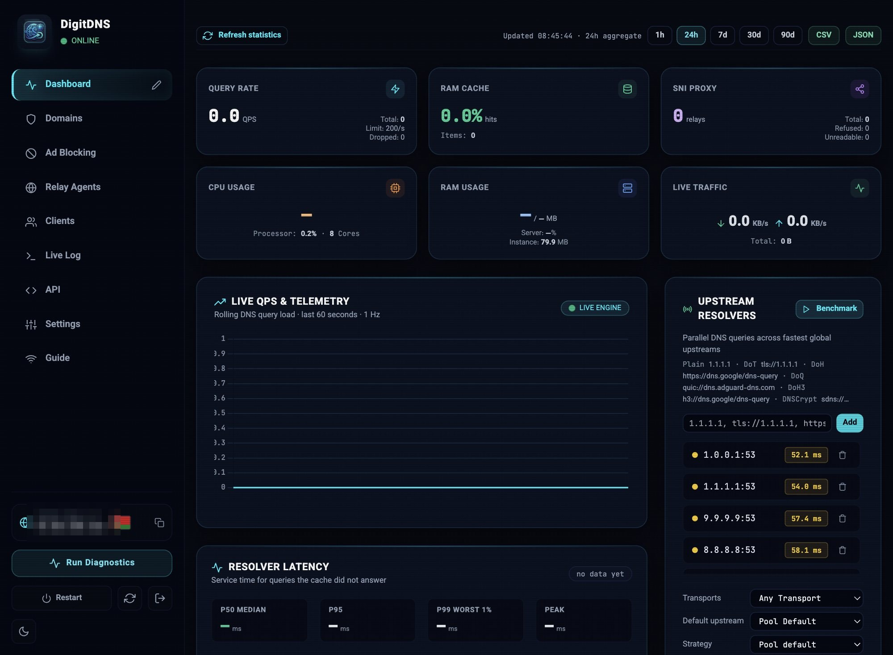
</p>

<p align="center">
  <a href="#quick-start">🚀 Quick start</a> •
  <a href="#installation">📦 Install</a> •
  <a href="#features">🌟 Features</a> •
  <a href="#client-area">👤 Client area</a> •
  <a href="#android-app">📱 Android</a> •
  <a href="#operations">🔧 Operations</a> •
  <a href="#security">🛡️ Security</a> •
  <a href="#screenshots">📸 Screenshots</a> •
  <a href="#documentation">📚 Docs</a>
</p>

---

## What's new in 5.1

**Graphite** is a neutral third theme for the web panel and the Android app,
alongside the existing Dark and Light modes. One theme button cycles
Dark → Grey → Light, the choice is stored, and the selected theme carries
through login and restarts. The release also removes the cyan highlights from
buttons, chips, selected states and card edges, and replaces the launcher icon
with a grey mark.

The 5.0.1–5.0.4 patch line remains included: DNS Rewrites bulk import, Queries
by Relay, unified uppercase card headings, allowed-only Top domains, live-log
and locale fixes, the multi-arch agent setup selector, and real arm64 hub/agent
images. See the latest release notes for details.

### 🛡️ Ad blocking engine

DigitDNS is now a DNS sink as well as a resolver. Blocked names are answered
before they reach an upstream, with the policy and list management in the same
panel.

- **45 curated blocklists** in five groups: General protection, Supplementary ads
  & trackers, Malware/phishing/scams, Device & vendor telemetry, and Optional
  extras. Sources include HaGeZi Pro / Light / Pro+ / Ultimate, OISD Big / Small,
  AdGuard DNS, 1Hosts Xtra / Lite, StevenBlack Unified, Peter Lowe, AdAway,
  Dan Pollock, URLhaus and Phishing Army.
- **Install in one click.** A recommended base is marked, each preset shows its
  description, licence, warning, homepage and complete raw file, and its domain
  count is scanned in the background before you commit.
- **Custom lists.** Subscribe to any hosts/Adblock URL, or upload a local file.
  Downloads are capped at 64 MB, uploads at 16 MB, duplicate URLs are rejected and
  parsing runs off the DNS hot path.
- **Policy you control.** Enable/disable blocking, choose `0.0.0.0`, `NXDOMAIN`
  or `REFUSED`, set the block TTL and update interval, and keep an always-allow
  list that wins over every blocklist.
- **Active lists first.** Enabled lists are pinned to the top under an **ACTIVE**
  heading on web and Android and removed from their catalogue groups, so what is
  actually blocking is the first thing you see.
- **Per-list lifecycle.** Toggle without deleting, update one list or all lists,
  refresh on the configured schedule (default 24 hours, checked every 15
  minutes), delete, and see unique domains, rules, allow/skipped entries and the
  last update.
- **Web and Android UI.** A full **Ad Blocking** tab on web and **Settings → Ad
  Blocking** on Android, including custom URL and file upload.
- **API v3.** `/api/v3/filtering` exposes status, settings, presets, list
  creation, enable/disable, update and delete for automation.

### 📊 Aggregated statistics

- **Five ranges:** 1h, 24h, 7d, 30d and 90d.
- **1h draws from real five-minute buckets.** The current hour is split into
  twelve slices, so the chart has 10–12 points as the hour progresses instead of
  a single dot. 24h/7d read hourly buckets; 30d/90d read daily buckets.
- **Aggregate-only storage.** `stats.db` keeps counters and bounded top-N tables,
  never the raw query log. Hourly buckets roll into daily history; retention
  defaults to 90 days.
- **Distinct clients with HLL.** HyperLogLog gives an unbounded distinct count;
  pre-HLL ranges say `top-N approx.`.
- **Six ranked tables:** domains, blocked domains, clients, upstreams, protocols
  and relay countries, with client names and relay flags.
- **Privacy controls.** HMAC-SHA256 client identifiers, per-store salt and an
  opt-out for up to 500 IPs or account names.
- **Sticky toolbar and exports.** Refresh on the left, range chips in the middle,
  CSV/JSON on the far right in the action colour. The row stays pinned while
  cards scroll underneath.
- **Every history card moves.** History cards participate in the dashboard layout
  editor alongside the live cards.

### 🧩 Free dashboard layout

- Cards move anywhere on a **12-column, 12-pixel-row grid**, across the metrics,
  main and history groups, and resize from any edge or corner.
- Collision-safe drops, saved v3 layout with automatic migration, and a reset
  action beside the edit pencil.
- The six live KPI cards wrap their meta columns, CPU line and traffic readings
  instead of clipping at narrow widths.

### 📱 Android 5.0.0

- Range chips in the top header beside **Online**, with the aggregate update
  clock next to them.
- No timestamp flashing during background polls; the same clock appears in the
  same place on the other live-backed screens.
- 1h five-minute chart, numeric chart axis with gridlines, and the six-metric
  summary in two compact rows of three.
- Full **Settings → Ad Blocking** screen with the preset catalogue, custom URL
  and file upload, active-first ordering, green active states and list actions.

### 🧭 Also in the 4.x line

- **Geo relay agents.** A small agent in another country carries encrypted TLS
  byte-for-byte, with per-domain and per-service relay choices, a real agent
  page, manageable keys, connection tests and multi-arch images.

---

## Screenshots

### Web dashboard

Live metrics, the sticky history toolbar, the 1h range and export actions. Cards
can be moved and resized freely.

<p align="center">
  
</p>

### Web history

The 1h range drawn from five-minute buckets, with the summary, stacked traffic
chart and ranked tables.

<p align="center">
  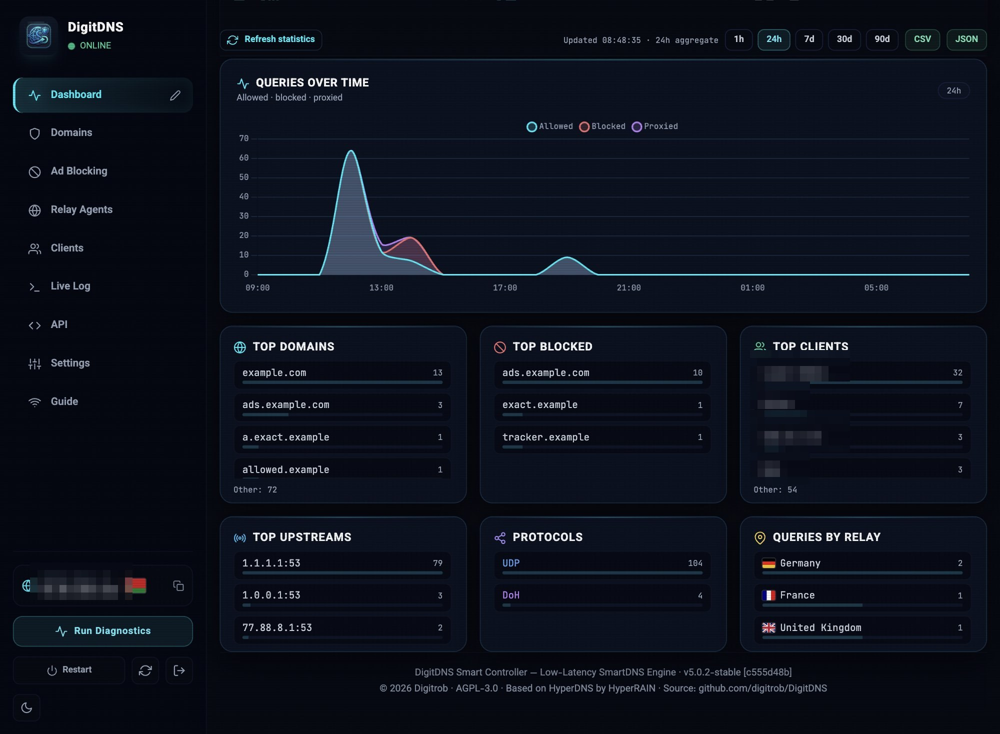
</p>

### Web ad blocking

Forty-five curated blocklists, custom URL and file lists, an allowlist, and the
enabled lists pinned under **ACTIVE** at the top.

<p align="center">
  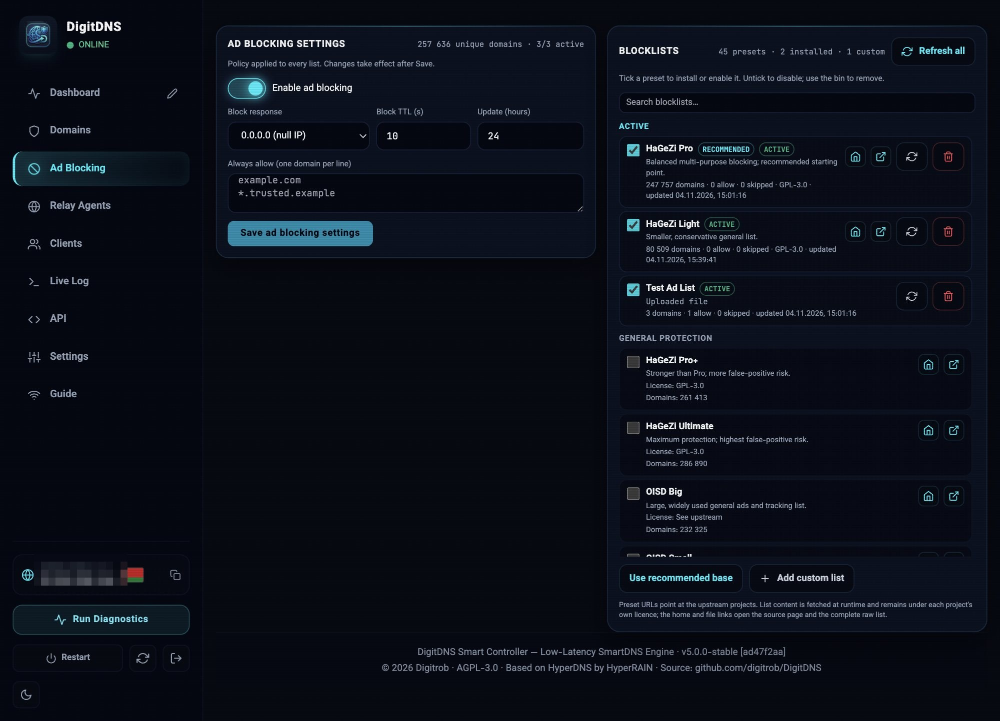
</p>

### Android

| Dashboard | History | Ad blocking |
| :---: | :---: | :---: |
| 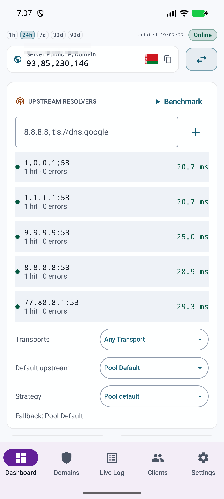 | 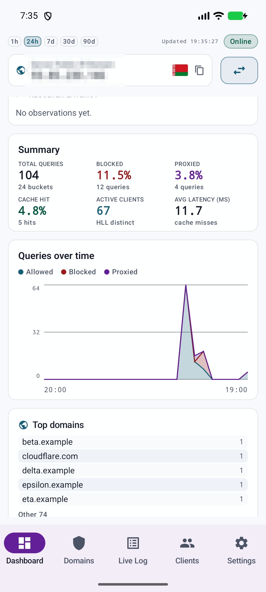 | 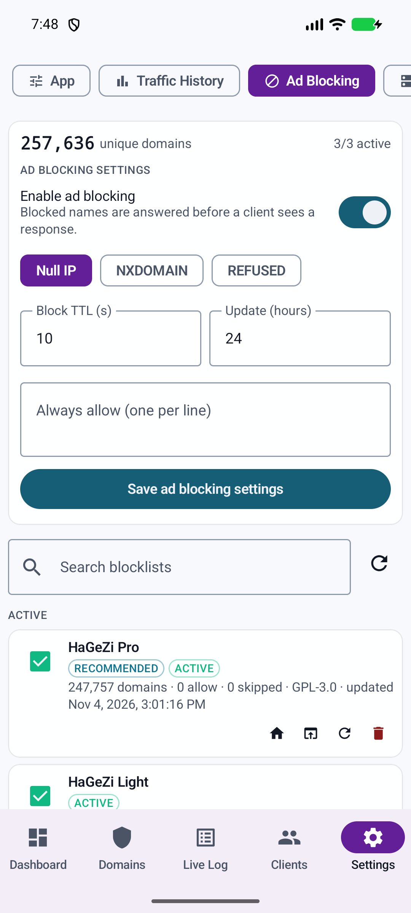 |

### Graphite theme

The neutral third theme, shared by the web panel and the Android app. One
three-state button cycles **Dark → Grey → Light** and stores the choice, so the
theme chosen on the login screen survives sign-in and app restarts.

<p align="center">
  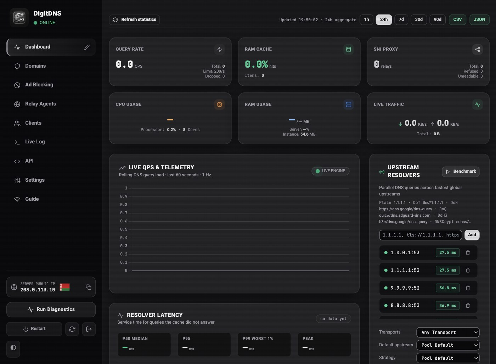
</p>

| Android login | Android dashboard | Android theme settings |
| :---: | :---: | :---: |
| 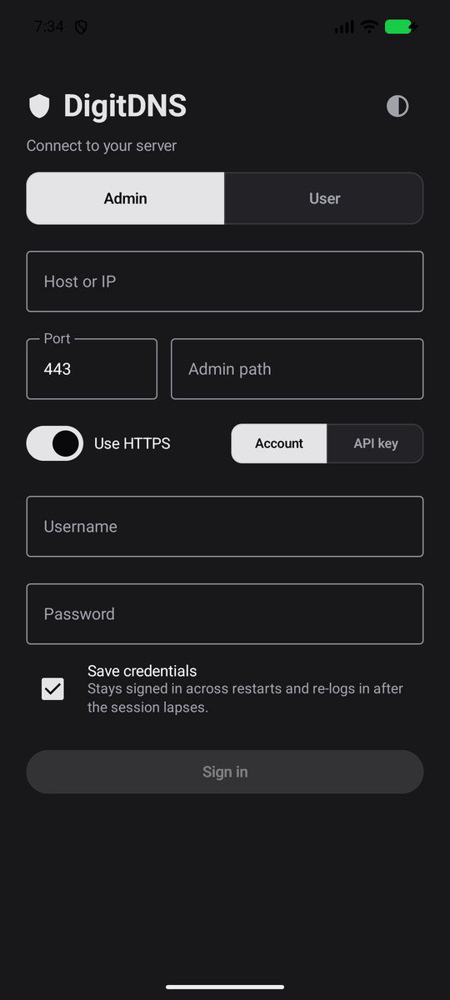 | 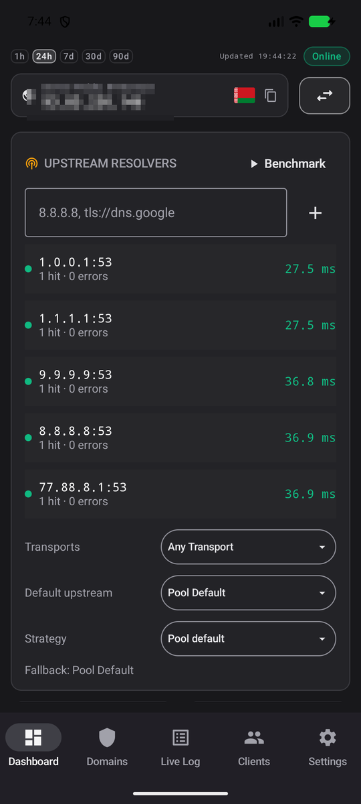 | 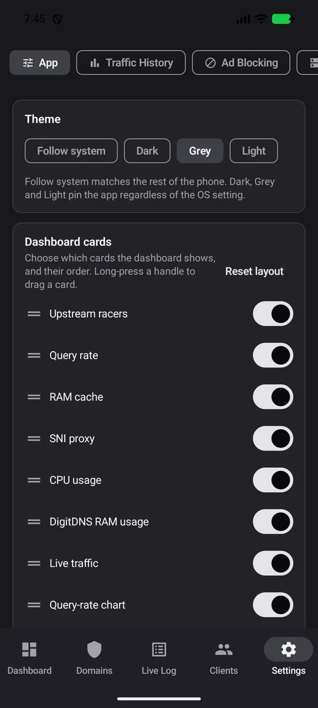 |

> Screenshots use a test server. The public address is replaced with a
> documentation address or pixelated; no client names are shown.

---

## Why DigitDNS

- **One binary, no runtime.** DNS, DoT, DoH, the TLS relay, the panel, the REST
  API, the subscriber portal and the self-updater are compiled into
  `digitdns`. The only state is a local encrypted database, a master key and a
  JSON config file.
- **Rules per domain, not a mystery blocklist.** Proxy, block or route direct,
  with wildcard scopes you can see (`exact`, `*.host`, `*.parent`), named
  groups, bulk import and one searchable Domains list.
- **A relay that never decrypts.** Proxied HTTPS is forwarded byte-for-byte.
  The server never holds the session keys or the plaintext.
- **Built for paying subscribers.** Per-client quotas, expiry, device limits,
  traffic accounting, a private portal link, a registration secret and an
  Android client area.
- **Encrypted DNS where it matters.** DoT and DoH for clients; DoT, DoH, DoQ,
  DoH3 and DNSCrypt for upstreams.
- **A Pi-hole / AdGuard Home alternative with a relay.** Run the 45-preset
  blocklist engine on its own, or let the same install bypass geo-blocks through
  SNI relay agents.

**What it is not:** a VPN. Only names you mark as proxied are relayed; all other
traffic keeps its direct path. It also does not hide your server's IP from the
destination of a proxied connection — that is the point of the relay.

<p align="center">
  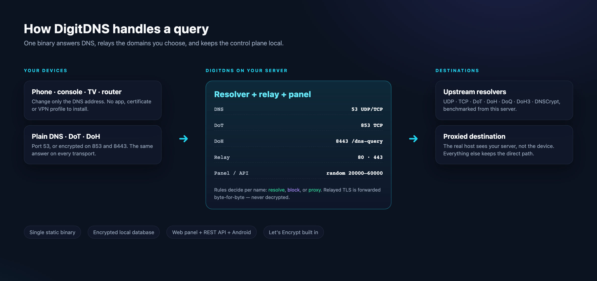
</p>

---

## Quick start

You need a Linux server (1 vCPU / 1 GB is enough for personal use), root
access, and one hostname whose **A record points at the server**. The panel is
HTTPS-only and obtains its own Let's Encrypt certificate, so the domain is not
optional for a normal install.

```bash
curl -fsSL https://raw.githubusercontent.com/digitrob/DigitDNS/v5.1.1/scripts/install.sh | sudo bash
```

The installer sets up the service, firewall, certificate, admin password and a
random panel port/path, then prints the login URL. Open it, sign in, and point a
device at the server's IP on port 53 (UDP and TCP).

Verify from another machine:

```bash
dig @YOUR_SERVER_IP example.com A
```

> [!IMPORTANT]
> Save the admin password and back up `master.key` from the data directory.
> The key encrypts every subscriber record; without it the database cannot be
> read. See [Backup & restore](#backup--restore).

---

## Requirements

| | Minimum | Comfortable |
| :--- | :--- | :--- |
| CPU / RAM | 1 vCPU, 1 GB | 2 vCPU, 2 GB (~10 active subscribers) |
| Disk | 1 GB | 5 GB (logs, certificates, database growth) |
| OS | Ubuntu 20.04+, Debian 11+, AlmaLinux/Rocky 8+ (systemd) | Ubuntu 22.04+ / Debian 12+ |
| Network | A public IPv4; IPv6 optional | Static IP, port 80 reachable for ACME |
| Domain | One hostname → server A record | A second hostname for DoH/DoT is optional |

**Ports**

| Port | Protocol | Purpose |
| :--- | :--- | :--- |
| 53 | UDP + TCP | Plain DNS for clients |
| 80 | TCP | ACME HTTP-01 challenge and the HTTP relay |
| 443 | TCP | HTTPS relay for proxied domains |
| 853 | TCP | DNS-over-TLS (when TLS is configured) |
| 8443 | TCP | DNS-over-HTTPS at `/dns-query` (when TLS is configured) |
| random 20000–60000 | TCP | Web dashboard; chosen at install and printed in the URL |

**Relay agent (optional)**

An agent needs a public IPv4, inbound TCP **80/443**, outbound HTTPS to the hub,
and no domain or certificate. It is Linux amd64/arm64. The hub keeps all other
requirements. Full manual: [docs/AGENT.md](docs/AGENT.md).

DoQ, DoH3 and DNSCrypt are **upstream transports**, not client-facing
listeners. Clients use plain DNS, DoT or DoH.

---

## Installation

### 1. One-line installer (Linux, recommended)

Interactive:

```bash
curl -fsSL https://raw.githubusercontent.com/digitrob/DigitDNS/v5.1.1/scripts/install.sh | sudo bash
```

Non-interactive:

```bash
DIGITDNS_DOMAIN=dns.example.com \
DIGITDNS_EMAIL=you@example.com \
bash install.sh
```

Optional environment variables:

| Variable | Meaning |
| :--- | :--- |
| `DIGITDNS_DOMAIN` | Panel hostname (must already point at the server) |
| `DIGITDNS_EMAIL` | Let's Encrypt account email |
| `DIGITDNS_PUBLIC_IP` | Override the detected public IPv4 |
| `DIGITDNS_FRESH=1` | Confirm a non-interactive fresh install / reinstall |

The installer supports amd64 and arm64, writes a systemd unit, opens the
required firewall ports, installs `restore.sh` and `uninstall.sh`, and archives
an existing install before upgrading it. Everything lives under
`/opt/digitdns`.

**Offline install:** download `digitdns-offline-bundle.tar.gz` (or `.zip`) from
the release page, copy it to the server, then run `install.sh` from the
extracted directory. The offline bundle is Linux amd64; it needs internet only
for the first certificate issuance.

### 2. Docker

Images are published for amd64 and arm64 and signed with cosign. The hub is
`ghcr.io/digitrob/digitdns`; the optional relay agent is
`ghcr.io/digitrob/digitdns-agent` (see [Relay agent](#6-relay-agent-optional)).

```bash
docker pull ghcr.io/digitrob/digitdns:latest

mkdir -p data certs
docker run -d --name digitdns --network host \
  -v "$PWD/data:/app/data" -v "$PWD/certs:/app/certs" \
  -e TZ=UTC \
  ghcr.io/digitrob/digitdns:latest
```

Or with Compose:

```yaml
services:
  digitdns:
    image: ghcr.io/digitrob/digitdns:latest
    container_name: digitdns
    restart: always
    network_mode: "host"
    volumes:
      - ./data:/app/data
      - ./certs:/app/certs
    environment:
      - TZ=UTC
    ulimits:
      nofile: { soft: 65535, hard: 65535 }
```

```bash
mkdir -p data certs && docker compose up -d
docker logs -f digitdns
```

**Host networking is required**, not a preference: the resolver must see real
client addresses for whitelisting, subscriber recognition and rate limiting,
and DNS/DoT/DoH are not simple `-p` mappings.

| Tag | Meaning |
| :--- | :--- |
| `latest` | Latest stable release |
| `5.1.1` | Sky-blue Proxy status in Graphite for web and Android, grey favicon (latest) |
| `5.1.0` | Graphite theme for web and Android, neutral controls, grey app icon (older) |
| `5.0.4` | Real arm64 hub/agent images and arm64 execution CI gate (older) |
| `5.0.3` | Multi-arch agent selector, copyable Docker command, arm64 CI gate (older) |
| `5.0.2` | Allowed-only Top domains, locale-safe UI, Rewrite filter and import polish (older) |
| `5.0.1` | Dashboard polish, DNS Rewrites, relay labels, unified cards (older) |
| `5.0.0` | Ad-blocking engine, aggregate stats, free dashboard layout (older) |
| `4.1.0` | 90-day traffic history, Android history cards (older) |
| `4.0.3` | Dashboard refresh, compact Settings, app-icon brand (older) |
| `4.0.2` | Accurate client-list status (older) |
| `4.0.1` | Agent log-throttling patch (older) |
| `4.0.0` | Geo relay agents (older) |
| `3.8.0` | A specific immutable release (older) |
| `edge` | Nightly build from `main` — not for production |

Verify the image:

```bash
cosign verify ghcr.io/digitrob/digitdns:latest \
  --certificate-identity-regexp 'https://github.com/digitrob/DigitDNS/.github/workflows/docker.yml@' \
  --certificate-oidc-issuer https://token.actions.githubusercontent.com
```

### 3. Pre-built binary + systemd

Release binaries are Linux amd64 and arm64. Checksums are published as
`checksums.txt` and signed as `checksums.sig`.

```bash
curl -fsSL -o digitdns \
  https://github.com/digitrob/DigitDNS/releases/download/v5.1.1/digitdns-linux-amd64
chmod +x digitdns
sudo install -m 0755 digitdns /opt/digitdns/digitdns
```

Use the canonical unit from `scripts/digitdns.service` (or adapt it):

```ini
[Unit]
Description=DigitDNS
After=network-online.target
Wants=network-online.target

[Service]
Type=simple
User=root
WorkingDirectory=/opt/digitdns
RuntimeDirectory=digitdns
RuntimeDirectoryMode=0700
ExecStart=/opt/digitdns/digitdns -daemon \
  -config /opt/digitdns/config.json \
  -db /opt/digitdns/data.db \
  -key /opt/digitdns/master.key
Restart=always
RestartSec=3s
LimitNOFILE=65535

[Install]
WantedBy=multi-user.target
```

Start with `./digitdns -server` on a fresh machine to generate the database,
key, config and first-run credentials; the service runs `-daemon`.

### 4. Build from source

Requires Go 1.26+.

```bash
git clone https://github.com/digitrob/DigitDNS.git
cd DigitDNS
go build -ldflags="-s -w" -o bin/digitdns ./cmd/digitdns
./bin/digitdns -server
```

The Go daemon builds on other operating systems for development, but the
installer, systemd unit and packaged binaries target Linux.

### 5. Android app

The companion APKs are attached to every release. See
[Android app](#android-app) for the architecture table and installation steps.

### 6. Relay agent (optional)

An agent is a second, much smaller process on a public IPv4 in the country you
want to exit from. It needs no domain, certificate, database or panel; only
outbound HTTPS to the hub and inbound TCP **80/443** for relayed traffic.

1. On the hub open **Settings → Relay Agents → Add agent**, choose the country,
   and copy the key shown after saving.
2. Run the container on the agent VPS:

```bash
mkdir -p /opt/digitdns-agent
docker run -d --name digitdns-agent --network host --restart unless-stopped \
  -v /opt/digitdns-agent:/data \
  ghcr.io/digitrob/digitdns-agent:latest \
  -hub 'https://panel.example.com:8080/ADMIN_PATH' \
  -key 'AGENT_ID:SECRET' \
  -listen :80,:443 \
  -state /data/agent-state.json
```

Host networking is required: the agent must see the real client address and
bind 80/443 without port remapping. The `-hub` value is the same panel origin
you use in a browser, including the hidden admin path.

3. Back on the hub, wait for the card to show **online**, press **Test
connection**, then assign domains or a service default to the agent.

The full manual — binary and systemd install, every flag, key rotation,
troubleshooting, sizing and security — is in [docs/AGENT.md](docs/AGENT.md).

### Migrating from HyperDNS

The installer detects `/opt/hyperdns`, archives it and migrates the data in
place. For a HyperDNS 1.x install, run `migrate-from-v1.sh` from the offline
bundle first.

---

## First run

On a fresh install the daemon generates:

- an admin password, printed **once**;
- a hidden 16-character admin path;
- a dashboard port between 20000 and 60000;
- `master.key`, `data.db` and `config.json` under `/opt/digitdns`.

The panel is at:

```
https://YOUR_DOMAIN:PANEL_PORT/ADMIN_PATH/login
```

The bare hostname intentionally shows nothing, so scanners cannot discover the
panel. Bookmark the full URL.

**Where things live**

| Path | What it is |
| :--- | :--- |
| `/opt/digitdns/data.db` | Encrypted subscriber/rule database |
| `/opt/digitdns/master.key` | Key that decrypts the database — back this up |
| `/opt/digitdns/config.json` | Server, DNS, relay, access and TLS settings |
| `/opt/digitdns/certs/` | Certificates |
| `/opt/digitdns/backups/` | Archives created by the installer |

Run `digitdns` with no arguments over SSH for the text console: status,
diagnostics, restart/stop, subscriber management, upstream benchmark, cache
flush, panel port, API key rotation, admin recovery and uninstall.

---

## Features

### Domains and routing

One Domains list holds proxied, paused, blocked and direct names, with status
chips, search, sort and bulk selection. You can change a row's routing from its
status badge without losing its place in the list.

- **Wildcard scopes you can see:** `exact` (host and subdomains), `*.host`
  (subdomains only), `*.parent` (the parent's subtree). Changing a scope
  rewrites the rule in place and keeps its row position.
- **Policy groups** bundle domains into named, enable/disable-able sets with
  optional icons.
- **Bulk import** accepts pasted or uploaded lists with `#` comments and
  `*.wildcards`.
- Built-in direct routing keeps a handful of high-bandwidth services (voice
  chat, game-store CDNs, OS update CDNs) off the relay.

### Services

Services are labels, not routing rules. A domain can belong to one service, and
selecting that service in the sidebar filters the Domains table down to it.

- Create a service with a name and an optional icon.
- Assign it from the row's **Service** control, or select several domains and
  use **Assign service**.
- Type a domain in the icon field to use its favicon, paste an image URL, or
  search a word such as `tv` or `music` for a colourful icon.
- Rename or delete a service without touching the domains themselves. Deleting
  clears the label; it never changes proxy, block or direct status.

The Services panel stays pinned while a long domain list scrolls, and the whole
page now uses the width of a wide monitor instead of stopping at a narrow
column.

### Dashboard

The dashboard is a live view, not a static report: QPS, cache hits, memory,
CPU, relay connections, bandwidth, latency percentiles and the current upstream
resolvers.

- **Arrange it yourself.** The pencil beside **Dashboard** in the sidebar turns
  on edit mode. Drag a card anywhere on the 12-column, 12-pixel-row grid and
  resize it from any edge or corner. Click the struck-through pencil to leave
  edit mode; the layout is saved on the server.
- **The same layout everywhere.** The arrangement is stored install-wide, so it
  is there in the next browser and on the next device.
- **Phones reorder too.** Long-press a card to pick it up. Sizes stay at the
  normal mobile stacking, because a resized card on a phone is rarely useful.

### Ad blocking

The DNS sink sits in front of upstream resolution and answers blocked names
directly.

- **Curated and custom lists.** 45 presets plus URL subscriptions and local file
  uploads in hosts or Adblock format.
- **Policy.** Enable/disable, `0.0.0.0` / `NXDOMAIN` / `REFUSED`, block TTL,
  update interval and an always-allow list.
- **Active first.** Enabled lists are pinned at the top of the web and Android
  list views and removed from their catalogue groups.
- **Per-list control.** Toggle, update, refresh all and delete, with unique
  domain, rule, allow, skipped and last-update counts.
- **Scheduling.** Lists refresh in the background on the configured interval; the
  DNS path only reads the compiled snapshot.
- **API.** Full management through `/api/v3/filtering`.

### Traffic history

The optional 90-day aggregate store answers “what did this server see last
week?” without retaining the queries themselves.

- **Aggregate-only storage.** A separate `stats.db` holds counters and bounded
  top-N tables; the raw query log remains an in-memory ring of 100 entries and
  is never written to disk.
- **Retention you control.** 7 days of hourly buckets roll into daily buckets,
  which default to 90 days. Top-N limits, retention and anonymization are edited
  under **Settings → Traffic History** and apply after a daemon restart.
- **Distinct clients with HLL.** HyperLogLog registers give an unbounded distinct
  count; the UI says `HLL distinct` and only falls back to `top-N approx.` for
  ranges that contain pre-HLL buckets.
- **Privacy options.** Client anonymization replaces the identifier with an
  HMAC-SHA256 keyed by a per-store salt. A per-client opt-out accepts up to 500
  IPs or account names and suppresses the identifier while still counting the
  query in totals.
- **Dashboard and API.** Range selector (1h / 24h / 7d / 30d / 90d), summary,
  stacked chart and six ranked tables on web and Android; CSV/JSON export on web;
  `stats/summary`, `stats/series`, `stats/top`, `stats/export` and
  `stats/settings` in API v3.
- **Five-minute 1h series.** The 1h range is split into twelve five-minute
  buckets so the graph draws through the hour; 24h and 7d use hourly buckets and
  30d/90d use daily buckets.
- **Names, not addresses.** Ranked client rows resolve the stored address to the
  client’s current name through the access index; an unknown or deleted client
  keeps its IP. Relay rows show the country flag and localized name.

### Proxy relay

Domains marked as proxied resolve to your server. The device opens TLS to the
server, which forwards the encrypted stream to the real host and back. No
decryption, no certificate substitution, up to 4,096 concurrent relays, with
optional TLS fragmentation for DPI resistance.

### Geo relay agents

An agent is an optional egress point in another country. The hub still resolves
the domain and enforces the client allowlist; the agent only carries the
encrypted stream. That separation is deliberate: a box in a foreign datacentre
holds no subscriber database and no panel credential.

**How a domain chooses its exit**

1. A domain override wins: **This Server**, a named agent, or **Inherit**.
2. With no override, the service's **Default relay** applies.
3. With no service default either, the local server is used.

**Setting it up**

- Add the agent on the hub, choose its country and copy the one-time key.
- Install the agent with Docker or the release binary. Keep the key out of shell
  history (use a file or an environment manager) and give it to the agent once.
- Open TCP 80/443 on the agent and allow outbound HTTPS to the hub. No inbound
  admin port is opened and no TLS certificate is installed on the agent.
- Assign domains from the row's relay control, set a service default in the
  service editor, or use bulk **Egress** for a selection.
- Press **Test connection** on the card. It performs a real TCP connect to the
  advertised relay port and records the latency; the badge is green under
  40 ms, amber above 40 ms and red above 80 ms.

**Operating an agent**

- The card shows last heartbeat, version, assigned domains, traffic and the
  services using it. An agent is online when its heartbeat is under two minutes
  old.
- **Rotate key** invalidates the old credential immediately. Update the agent's
  key and restart it. A key created before encrypted copy storage existed must
  be rotated once before the card can copy it again.
- Disabling or deleting an agent stops its relay immediately. Assignments fall
  back to This Server; delete removes those assignments from both the domain and
  service maps.
- Agents are IPv4-only. No agent certificate or agent domain is required for
  relay traffic; the client's TLS session is passed through untouched.
- Update an agent the same way you update the hub: pull the new image or replace
  the binary, then restart. Keep `/data/agent-state.json` — it holds the key and
  the last catalogue.

Full manual: [docs/AGENT.md](docs/AGENT.md).

### Subscribers and quotas

- Per-client traffic quota, reset cycle, expiry, device limit, notes and policy
  set.
- Whitelist mode by default: unknown source addresses are refused.
- Per-client traffic is metered through the relay and persisted every 30
  seconds.
- Registration secret lets a subscriber rebind their IP without an admin.
- Copy-ready provisioning card and subscription link for Telegram or your own
  bot.

### Client area

A subscriber gets a private link (`https://your-server/sub/<token>`) and, on
Android, the same surface natively:

<p align="center">
  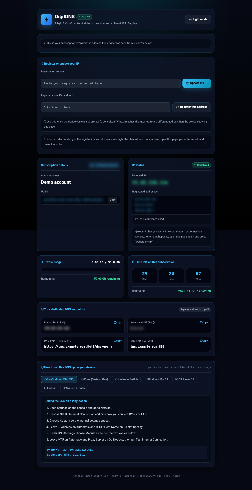
</p>

- **Status** — account state, detected IP, traffic, quota, reset and expiry;
  Registration Secret and Registered Address controls at the bottom.
- **Connect** — every registered address and subnet, plus DNS, DoH and DoT
  endpoints with copy buttons.
- **Guide** — complete setup steps for PlayStation, Xbox, Switch, Windows,
  iOS/macOS, Android and routers, using the live values for that subscription.
- **Saved subscriptions** — the app keeps a subscription with its account name
  above the admin servers, with one-tap reopen and **Switch to Admin**.

### Encrypted DNS

| Transport | Direction | Where |
| :--- | :--- | :--- |
| DoT | Clients and upstreams | Client listener on 853; upstream `tls://host` |
| DoH | Clients and upstreams | Client listener on 8443 `/dns-query`; upstream `https://host/dns-query` |
| DoQ | Upstreams | `quic://host` |
| DoH3 | Upstreams | `h3://host/dns-query` |
| DNSCrypt | Upstreams | `sdns://…` stamp |

Client DoT/DoH need a valid certificate, so they require a domain. The server
keeps upstream connections alive between queries to cut handshake latency.

### Upstream resolvers and policy

- Plain UDP/TCP, DoT, DoH, DoQ, DoH3 and DNSCrypt upstreams, benchmarked live
  from your server.
- Global **Default upstream**, **Strategy** and **Transports** policy.
- Strategies: **Fastest Wins**, **In Order**, **Hedged** (next resolver after
  50 ms) and **Best Known** (fastest measured, then latency order on failure).
- Transport policies: **Any Transport**, **Encrypted Only**, **Regular DNS** —
  enforced, not advisory.
- Per-domain overrides from the Domains gear; failures fall back to the pool.

### Certificates and diagnostics

- Embedded ACME client: issues and renews the panel certificate, plus an
  optional DoH/DoT certificate, without certbot or cron.
- Diagnostics with operator-defined targets, a reachability score and
  per-target latency.
- Server location from a self-updating GeoIP database, and in-panel update
  checks with signature verification.
- REST API v2/v3 with Swagger docs at
  `https://YOUR_DOMAIN:PANEL_PORT/ADMIN_PATH/api/v3/docs`.

---

## A look at it

<p align="center">
  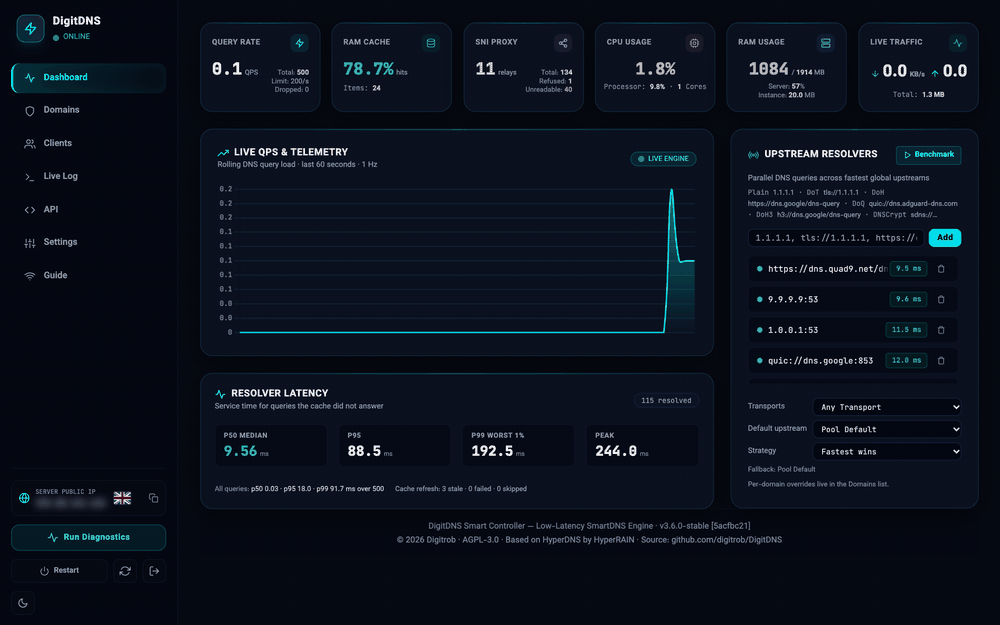
</p>

| Domains | Clients |
| :---: | :---: |
| 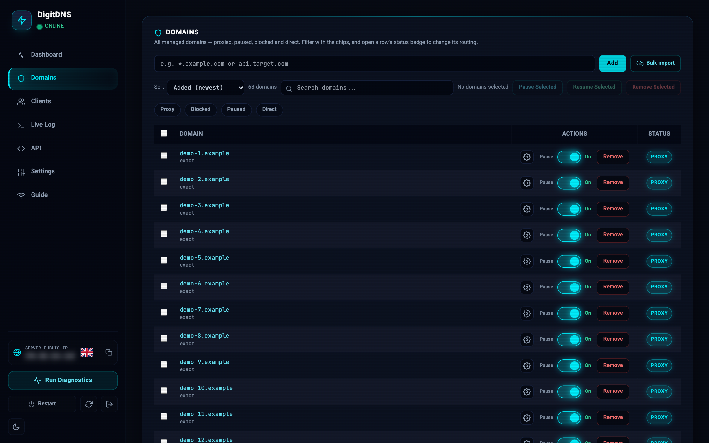 | 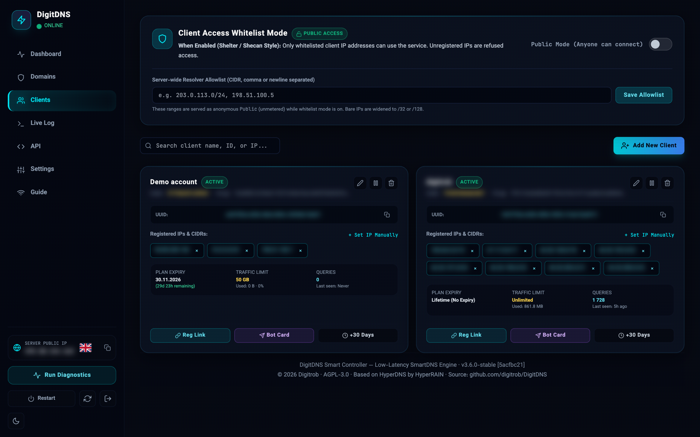 |

## Android app

The Android app is a native companion with the same control surface as the
panel. It has its own version line (`android-v5.1.1`) and is side-loaded; it is
not on Play.

| APK | Architecture |
| :--- | :--- |
| `digitdns-arm64-v8a.apk` | 64-bit ARM — almost every phone since ~2016 |
| `digitdns-armeabi-v7a.apk` | 32-bit ARM — older devices |
| `digitdns-x86_64.apk` | Emulators and some tablets |
| `digitdns-universal.apk` | All of the above, larger |

Download from the [latest release](https://github.com/digitrob/DigitDNS/releases/latest)
and verify against the matching `.sha256`. Requires **Android 10 (API 29)** or
newer.

It covers the dashboard, Domains and wildcards, Clients and quotas, the live
query log with quick actions, upstream resolvers and policies, diagnostics,
certificates, settings and server switching (multiple saved servers, saved
credentials, API keys with an optional **Save key** tick). It also has the
subscriber client area.

On the Domains screen, long-press a row to start a selection. The selection bar
keeps Pause, Resume, Remove, **Assign service** and **Egress** on one line, and
the service filter uses the same labels and icons as the web panel. The second
line of a proxied row shows an icon-only service mark and relay flag; tapping
the service mark opens the service picker, and tapping the flag opens the relay
picker without moving the row's gear, status pill or switch.

**Settings → Relay Agents** is the mobile agent catalogue. Cards show the public
IP and masked key with copy buttons, a rotate-key action, version, last seen,
assigned domains, traffic and service defaults. **Test connection** opens a real
TCP connection to the relay port and updates the ping badge. The layout is one
card wide on a phone and two side by side on a tablet or in landscape.

**Traffic History** is part of the same dashboard: range switching, six KPI
tiles, the stacked traffic chart, top domains/blocked/clients/upstreams/
protocols/relay countries, flags and client names. Ranked cards are fixed-height
with five or three visible rows and internal list scrolling. **Settings →
Traffic History** edits the server-wide retention, top-N, anonymization and
client opt-out policy.

The app keeps its own version, so a server update never forces an app update.

<p align="center">
  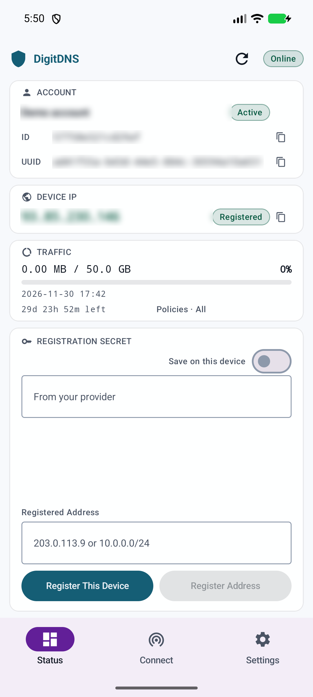
  &nbsp;&nbsp;
  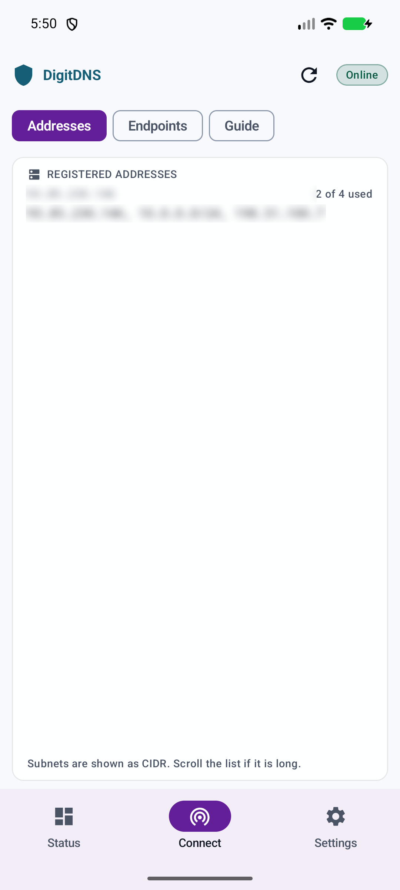
</p>

---

## Operations

### Upgrade

- **Panel:** Settings → Server Update checks for a signed release and installs
  it with a backup and restart.
- **Docker:** `docker pull ghcr.io/digitrob/digitdns:latest && docker compose up -d`.
- **Binary:** replace `/opt/digitdns/digitdns`, then `systemctl restart digitdns`.
- **Installer:** rerun it; the existing install is archived first.
- **Relay agents:** pull the new `ghcr.io/digitrob/digitdns-agent` image (or
  replace the binary) and restart. `/data/agent-state.json` survives; it holds
  the agent key and last catalogue.

Back up before any upgrade. Database and config format changes are handled
automatically, but `master.key` must travel with `data.db`.

### Backup & restore

Stop the service before copying the database for a consistent snapshot:

```bash
sudo systemctl stop digitdns
sudo tar -czf /root/digitdns-backup-$(date +%F).tar.gz \
  -C /opt/digitdns data.db master.key config.json certs
sudo systemctl start digitdns
```

Keep the archive off the server. Restore with the service stopped by putting the
four items back, or use `scripts/restore.sh` for an archive produced by the
uninstaller. Never restore an old `master.key` into a fresh database — it will
not decrypt it.

### Logs

```bash
sudo journalctl -u digitdns -f          # systemd install
docker logs -f digitdns                 # hub container
docker logs -f digitdns-agent           # relay agent container
```

### Troubleshooting

| Symptom | Check |
| :--- | :--- |
| Blank page or 404 at the hostname | You need the full hidden URL with the panel port and admin path |
| Certificate issuance fails | A record points at this server; port 80 is open; Let's Encrypt rate limits |
| `dig` times out | Port 53 UDP/TCP open in the firewall; the service is running |
| DNS works but sites do not | Ports 80/443 must be reachable for the relay |
| Subscriber shows "not registered" | Their current public IP differs; register it with the secret |
| Phone cannot use Private DNS | Use the hostname, not an IP; it needs a valid DoT certificate |
| Locked out of the panel | Run `digitdns` over SSH → **Emergency admin reset** |
| `master.key` lost | The database is unrecoverable; restore a backup |
| Agent card says offline | Check its heartbeat: outbound HTTPS to the hub, the key, and the hub URL including the admin path |
| Agent says empty host allowlist | No active proxied domain or service resolves to it; assign one and wait for the 60 s catalogue sync |
| Agent test connection fails | The advertised relay port is not reachable: open TCP 80/443 and check the agent is binding `:80,:443` |
| Agent card cannot copy the key | The key predates encrypted storage; use **Rotate key**, then copy the new one |

### Uninstall

```bash
sudo /opt/digitdns/scripts/uninstall.sh
```

The uninstaller archives data and offers a restore script. The TUI option
**Uninstall DigitDNS** does the same.

---

## Security

- Save the generated admin password; enable **two-factor authentication**.
- Keep the hidden admin path and panel port private.
- Keep **whitelist mode** on. An open resolver is abused within hours.
- Back up `master.key` offline; it is the only way to read `data.db`.
- Expose only the ports you use. The dashboard does not need to be public if
  you reach it through a VPN or SSH tunnel.
- The API binds to `127.0.0.1` by default; widen it deliberately.
- Release checksums are signed, Docker images are cosign-signed and the
  in-panel updater verifies signatures before installing.

Full threat model and hardening guide: [docs/SECURITY.md](docs/SECURITY.md).

---

## API & automation

REST API v2 and v3 cover clients, domains, settings, resolution policy,
upstreams, diagnostics and updates. Authenticate with a dashboard session or the
master API key (`X-API-Key`). Contracts, payloads and Python/Node/cURL examples
are in [docs/API.md](docs/API.md). Swagger is served from the panel at
`/ADMIN_PATH/api/v3/docs`.

---

## FAQ

**Do I need a domain?** For the panel and client DoT/DoH, yes — the panel is
HTTPS-only and DoT/DoH need a trusted certificate. A pure DNS lab can run
without one, but that is not the supported install path.

**Does it hide my IP from websites?** Proxied domains see your server's IP, not
the client's. Direct domains see the client's own IP as usual. This is not a
VPN.

**Can I share it with family or customers?** Yes — that is what clients,
quotas, expiry, device limits and the portal are for. Keep whitelist mode on.

**Does it work behind Cloudflare or another CDN?** No. DNS and the relay need
direct access to the server's ports; a proxying CDN breaks both.

**Are Windows/macOS server binaries published?** No. The daemon builds from
source on Go-supported systems, but release binaries, installers and the
systemd unit target Linux.

**Is the Android app on Play Store?** No. Signed APKs are attached to each
release and side-loaded.

**Will upgrades keep my data?** Yes; the schema is migrated automatically. Back
up `data.db` and `master.key` first.

**Where is my dashboard layout stored?** In the encrypted database as a custom
policy, not in the browser. It is shared by every browser that signs in to the
same install.

---

## Documentation

| Document | Contents |
| :--- | :--- |
| [Tutorial](docs/TUTORIAL.md) | First boot, domain, first client, registration — start here |
| [Security](docs/SECURITY.md) | Threat model, encryption, hardening, RFC notes |
| [API](docs/API.md) | REST v2/v3 with examples |
| [Changelog](docs/CHANGELOG.md) | Every release |
| [Relay agents](docs/AGENT.md) | Install, operate and troubleshoot a geo agent |
| [Releasing](docs/RELEASING.md) | Versioning and update channels |

Release channels: `latest` and untagged `vX.Y.Z` releases are stable; `-beta`
tags are prereleases and never take the *Latest* badge.

---

## Support

If DigitDNS helps you, you can support development:

| Method | Address |
| :--- | :--- |
| USDT (TRC20) | `TWrapnstisV3ZZsEgrfKDs2552SMc86VLE` |
| USDT (ERC20) | `0xd52Edf3767080cfE3E7037b9bAd2f9Aa7a8833C4` |
| TON | `UQBV9O4TlKdnrqVqsbPD83ClBE_POBHHXD-HFYqWnqhvWDo` |

---

## License

AGPL-3.0, the same as the upstream project. This is a modified fork of
**HyperDNS** by HyperRAIN ([github.com/IzumiRain/HyperDNS](https://github.com/IzumiRain/HyperDNS));
original copyright notices are retained. See [NOTICE](NOTICE) for attribution
and a summary of changes.

Source: [github.com/digitrob/DigitDNS](https://github.com/digitrob/DigitDNS)
