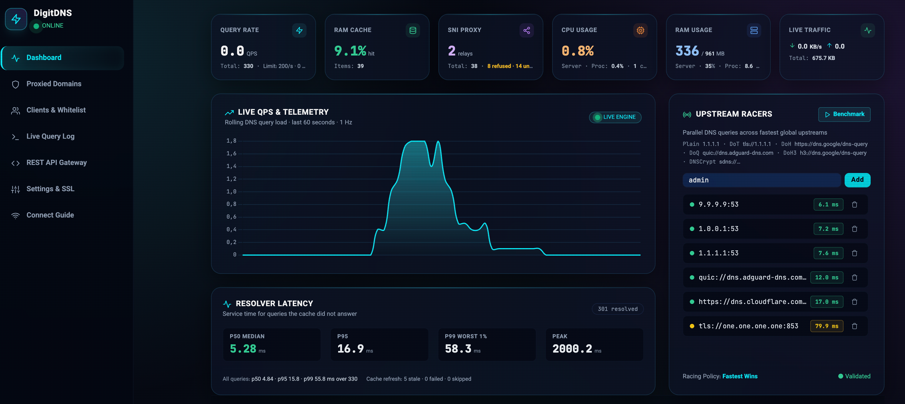

# ⚡ DigitDNS

[](https://github.com/digitrob/DigitDNS/releases/latest)
[](https://github.com/digitrob/DigitDNS/actions/workflows/docker.yml)
[](https://go.dev)
[](LICENSE)

**Your own smart DNS server with a built-in proxy relay and web dashboard.**
Point your devices (or your subscribers' devices) at it, and it decides for every
domain: resolve normally, block it, or quietly route the connection through your
server — so blocked or throttled services work again, while everything else keeps
its direct, fast path.

Forked from [HyperDNS](https://github.com/IzumiRain/HyperDNS) by HyperRAIN,
maintained by [Digitrob](https://github.com/digitrob). Free, open-source
(AGPL-3.0), no account required, no cloud dependency — you run it on your own
VPS. For self-hosting and education; only use it on servers and networks you're
allowed to operate.

<p align="center">
  
</p>

<p align="center">
  <a href="#-install">🚀 Install</a> •
  <a href="#-what-it-does">💡 What It Does</a> •
  <a href="#-features">🌟 Features</a> •
  <a href="#-after-you-install">🔒 Setup</a> •
  <a href="#-dashboard">🖥️ Dashboard</a> •
  <a href="docs/TUTORIAL.md">📖 Tutorial</a> •
  <a href="docs/API.md">🔌 API</a> •
  <a href="docs/SECURITY.md">🛡️ Security</a>
</p>

---

## 💡 What It Does

DigitDNS is one program that does three jobs:

1. **It's a DNS server.** Devices ask it "where is this domain?" and it answers.
   It speaks plain DNS as well as the encrypted kinds (DoT, DoH, DoQ, DNSCrypt),
   so phones, consoles and routers can all use it.

2. **It's a proxy relay.** For domains you mark as "proxied", it tells the device
   to connect to *your server* instead of the real site. Your server then relays
   the encrypted traffic straight through — it never decrypts it and never sees
   what's inside. This is how a blocked or throttled game store, chat app, or
   update service starts working again.

3. **It's a small hosting panel.** A web dashboard manages everything: who may
   use it, which domains go where, upstream servers, certificates, traffic
   stats. There's also a REST API if you want to run a billing bot or automate
   client management.

The classic use case: a cheap VPS in another country becomes a **private gaming
DNS** for your console or for paying subscribers. Your PlayStation, Xbox, Switch
or router just changes its DNS address — no app to install, no VPN to run. Game
traffic itself still goes direct to the real servers (lowest ping), while the
domains your ISP blocks get relayed through your VPS instead.

A 1-vCPU / 1 GB VPS handles personal use; a 2 vCPU box comfortably serves around
ten subscribers. It's a single static binary — no database server, no runtime
dependencies.

---

## 🚀 Install

**Four ways to get it — pick whatever fits you:**

| Way | Best for |
| :--- | :--- |
| 📦 **One-line installer** | Bare Linux servers — recommended; sets up the service, certificate and updates for you |
| 🐳 **Docker image** | Container fans — `ghcr.io/digitrob/digitdns:latest` |
| 📁 **Pre-built binaries** | Windows, macOS, or running it by hand |
| 🔧 **Build from source** | Contributors — `go build` from this repo |

Every release ships all of: install scripts, signed binaries for Linux /
Windows / macOS (amd64 + arm64), and a multi-arch container image. The full
source is right here on GitHub.

### Option 1: One-Line Installer (Linux)

As `root` on Ubuntu 20.04+, Debian 11+, or AlmaLinux/Rocky 8+:

```bash
curl -fsSL https://raw.githubusercontent.com/digitrob/DigitDNS/v3.0.0/scripts/install.sh | sudo bash
```

The installer needs a **domain pointed at your server** (A record → server IP).
It obtains a Let's Encrypt certificate by itself — no certbot, no manual steps —
and prints your dashboard address (including its random port), secret admin
path and admin password when it's done.

Non-interactive example:

```bash
DIGITDNS_DOMAIN=dns.example.com DIGITDNS_EMAIL=you@example.com bash install.sh
```

> [!NOTE]
> **Coming from HyperDNS?** The installer detects the old `/opt/hyperdns`
> install, archives it, and migrates your data in place — nothing is wiped.

### Option 2: Docker

Works on amd64 and arm64. Images are published to GitHub Container Registry
and signed, so you can verify what you're pulling.

```bash
docker pull ghcr.io/digitrob/digitdns:latest

mkdir -p data certs
docker run -d --name digitdns --network host \
  -v ./data:/app/data -v ./certs:/app/certs \
  -e TZ=UTC \
  ghcr.io/digitrob/digitdns:latest
```

Or with Compose:

```yaml
services:
  digitdns:
    image: ghcr.io/digitrob/digitdns:latest
    container_name: digitdns
    restart: always
    network_mode: "host"
    volumes:
      - ./data:/app/data
      - ./certs:/app/certs
    environment:
      - TZ=UTC
    ulimits:
      nofile: { soft: 65535, hard: 65535 }
```

```bash
mkdir -p data certs && docker compose up -d
```

Everything that must survive a restart lives in `data/` (database, keys,
config). The container uses host networking on purpose — the server needs to
see real client IP addresses to recognize subscribers and rate-limit
correctly.

On first start the daemon generates your admin password, a secret dashboard
path, and a random dashboard port — all printed once to the container log:

```bash
docker logs digitdns
```

**Which tag should I use?**

| Tag | What it is |
| :--- | :--- |
| `latest` | Latest stable release — use this |
| `3.0.0` | A specific immutable release |
| `edge` | Nightly/dev build from the default branch — not for production |

Verify an image's signature (proves it was built by this repo's CI):

```bash
cosign verify ghcr.io/digitrob/digitdns:latest \
  --certificate-identity-regexp 'https://github.com/digitrob/DigitDNS/.github/workflows/docker.yml@' \
  --certificate-oidc-issuer https://token.actions.githubusercontent.com
```

### Option 3: Binaries

Download from the [latest release](https://github.com/digitrob/DigitDNS/releases/latest) —
assets include `digitdns-linux-amd64`, `digitdns-linux-arm64`,
`digitdns-windows-amd64.exe`, `digitdns-darwin-arm64`, `digitdns-darwin-amd64`.
Checksums are in `checksums.txt` (signed with the project's release key).

```bash
# Linux amd64 example:
curl -fsSL -o digitdns https://github.com/digitrob/DigitDNS/releases/download/v3.0.0/digitdns-linux-amd64
chmod +x digitdns
sudo ./digitdns -server
```

### Option 4: Build from Source

```bash
git clone https://github.com/digitrob/DigitDNS.git
cd DigitDNS
go build -ldflags="-s -w" -o bin/digitdns ./cmd/digitdns
./bin/digitdns -server
```

---

## 🖥️ What You Need

| | Minimum | Recommended |
| :--- | :--- | :--- |
| **Server** | 1 vCPU, 1 GB RAM | 2 vCPU, 2 GB RAM (for ~10 subscribers) |
| **OS** | Any Linux, Windows, macOS | Ubuntu 22.04+ |
| **Domain** | One hostname pointing at the server | — |

**Ports the server listens on:**

| Port | What it's for |
| :--- | :--- |
| 53 (UDP+TCP) | DNS — the main service clients connect to |
| 443 (TCP) | Proxy relay for proxied HTTPS traffic |
| 80 (TCP) | Certificate issuance + HTTP relay |
| 8443 (TCP) | DNS-over-HTTPS |
| 853 (TCP) | DNS-over-TLS |
| **random port** (TCP) | Web dashboard — picked automatically at first install (between 20000 and 60000), printed in your login URL, and opened in the firewall by the installer. You can change it later in Settings or with TUI option `11`. |

If something else already owns port 53, 443, or 8443, the installer warns you
before anything is installed.

---

## 🌟 Features

### Proxy, Block, or Direct — Your Choice

You decide which domains are proxied, blocked, or resolved normally — no
built-in "recommended" list is forced on you. Manage it all from the dashboard:

- **Proxied** — traffic for these domains relays through your server (for
  blocked/throttled services).
- **Blocked** — these domains are refused (ads, telemetry, whatever you don't
  want phoning home).
- **Direct** — force these to resolve normally, even if a rule above would
  proxy them.
- **Groups** — bundle domains into named groups you can toggle on/off as a
  unit, with optional icons.
- **Bulk import** — paste or upload a whole list at once. Wildcards (`*.foo.com`)
  and comments (`#`) are supported.

A handful of high-bandwidth services (Discord voice, Steam's connection
manager, Google update CDNs) are always resolved directly so game downloads
and voice chat use the player's own connection, not your server's bandwidth.

### The Proxy Relay (Why Consoles Don't Need a VPN)

When a device looks up a proxied domain, DigitDNS answers with *your server's*
address. The device then opens a connection to your server, and the server
forwards it to the real destination. From the outside it just looks like the
device is talking to your server.

- The encrypted traffic is passed through untouched — the server relays bytes,
  it never holds decryption keys.
- Optional TLS fingerprint obfuscation helps the connection look like ordinary
  HTTPS, which matters when DPI systems try to detect proxies.
- Handles up to 4,096 connections at once, then politely refuses new ones
  instead of falling over.
- No client software needed: change the DNS address on the console, phone, or
  router, and you're done.

### Subscribers & Accounts

- Add clients from the dashboard or API, each with their own traffic quota,
  expiry date, and allowed devices.
- **Whitelist mode (default):** unknown devices are refused — only people you
  add can use your DNS. Turn this off if you want an open resolver (not
  recommended).
- Each subscriber gets a private link where they can see their own status, and
  a one-click way to update their IP (useful on mobile or home connections
  where the address changes).
- Send a Telegram provisioning card with the portal link, DNS address, and
  registration details in one tap.

### Encrypted DNS

Clients can use encrypted connections instead of plain DNS:

- **DoT** (DNS-over-TLS) on port 853 — what Android's "Private DNS" uses
- **DoH** (DNS-over-HTTPS) on port 8443 — what browsers and desktop apps use
- **DoQ** (DNS-over-QUIC) and **DNSCrypt** for the newest/fastest options

Connections are kept alive between queries so phones don't re-handshake every
time they look something up — less latency, less battery use.

### Upstream Servers

Forward queries to whatever upstream you like — Cloudflare, Google, your own
recursive server, or a chain of them. Encrypted upstreams (DoT, DoH, DoQ,
DNSCrypt) are supported too, and the dashboard benchmarks each one so you can
see which is fastest from your server.

### Certificates Without Certbot

The server obtains and renews its own HTTPS certificates (Let's Encrypt) while
running — no certbot, no cron jobs, no downtime when a certificate renews.
Point your domain at the server and it handles the rest.

### Web Dashboard & API

Full admin panel for everything above, plus a REST API with Swagger docs for
automation (billing bots, client provisioning, monitoring). See
[docs/API.md](docs/API.md).

### Terminal Interface

Run the `digitdns` command with no arguments for a simple text menu: check
status, restart the service, add/remove subscribers, benchmark upstreams,
flush the cache — handy over SSH when you don't want to open a browser.

---

## 🔒 After You Install

A few things to know before you let anyone else use it:

1. **Save your admin password.** It's printed once during installation and
   can't be recovered (only reset). Store it somewhere safe.

2. **The dashboard is hidden.** On first start, the server generates a secret
   path and prints your login URL once — something like
   `https://yourdomain.com:28443/a1b2c3d4e5f6g7h8/login` (note the random
   port). Bookmark it. The main website shows a blank page on purpose so
   scanners don't find your panel.

3. **Back up `master.key`.** It's in the data directory and encrypts all your
   subscriber records. Lose it and your data is unreadable; keep it off the
   server where possible.

4. **Whitelist mode stays on** unless you deliberately want anyone to use your
   resolver. An open DNS server gets abused within hours.

Full hardening guide: [docs/SECURITY.md](docs/SECURITY.md).

---

## 🖥️ Dashboard

The web panel manages everything:

- **Live stats** — queries per second, cache hits, traffic, latency, who's
  using it right now
- **Domain rules** — add/edit/proxy/block/direct, bulk import, live query log
  with one-click actions (see a domain in the log? Click to block or proxy it)
- **Clients** — add subscribers, set quotas and expiry, suspend, see usage
- **Upstreams** — add and benchmark DNS upstreams on any transport
- **Settings** — 2FA, hidden path, certificates, portal branding, API keys

Subscriber-facing pages (where clients check their own status) can be
customized with your own domain, title, and CSS to match your branding.

---

## 📚 Documentation

| Document | What's in it |
| :--- | :--- |
| **[Tutorial](docs/TUTORIAL.md)** | Step-by-step: first boot, custom domain, adding clients, registration tokens — **start here** |
| **[Security](docs/SECURITY.md)** | Threat model, encryption details, hardening, RFC compliance |
| **[API Reference](docs/API.md)** | REST API v1 & v2, with Python / Node.js / cURL examples |
| **[Changelog](docs/CHANGELOG.md)** | What changed in each release |
| **[Releasing](docs/RELEASING.md)** | Version policy and update channels |

**Versions:** the project follows SemVer. `latest` Docker tag and GitHub
releases track stable; `-beta` tags are prereleases. Release binaries are
signed; Docker images are cosign-signed.

---

## ☕ Support

If this project helps you out, you can support ongoing development:

| Method | Address |
| :--- | :--- |
| USDT (TRC20) | `TWrapnstisV3ZZsEgrfKDs2552SMc86VLE` |
| USDT (ERC20) | `0xd52Edf3767080cfE3E7037b9bAd2f9Aa7a8833C4` |
| TON | `UQBV9O4TlKdnrqVqsbPD83ClBE_POBHHXD-HFYqWnqhvWDo` |

---

## 📜 License

DigitDNS is licensed under **AGPL-3.0**, the same as its upstream project.

This is a modified fork of **HyperDNS** by HyperRAIN
([github.com/IzumiRain/HyperDNS](https://github.com/IzumiRain/HyperDNS)),
used under AGPL-3.0. Original copyright notices are retained; see
[NOTICE](NOTICE) for the full attribution and a summary of what changed in
this fork.

Source code: [github.com/digitrob/DigitDNS](https://github.com/digitrob/DigitDNS)
