<p align="center">
  
</p>

<h1 align="center">DigitDNS</h1>

<p align="center">
  <strong>Your own DNS. Your rules. No VPN.</strong><br>
  A self-hosted DNS server that blocks ads, encrypts every lookup and relays only the domains you choose.
</p>

<p align="center">
  <a href="https://github.com/digitrob/DigitDNS/releases/latest"></a>
  <a href="LICENSE"></a>
  <a href="https://github.com/digitrob/DigitDNS/actions/workflows/ci.yml"></a>
  <a href="https://github.com/digitrob/DigitDNS/actions/workflows/docker.yml"></a>
  <a href="https://github.com/digitrob/DigitDNS/actions/workflows/android.yml"></a>
  <a href="go.mod"></a>
</p>

<p align="center">
  <a href="#quick-start">Quick start</a> ·
  <a href="#features">Features</a> ·
  <a href="#screenshots">Screenshots</a> ·
  <a href="#manuals">Manuals</a> ·
  <a href="#the-android-app">Android</a> ·
  <a href="#api-and-automation">API</a> ·
  <a href="docs/CHANGELOG.md">Changelog</a>
</p>

<p align="center">
  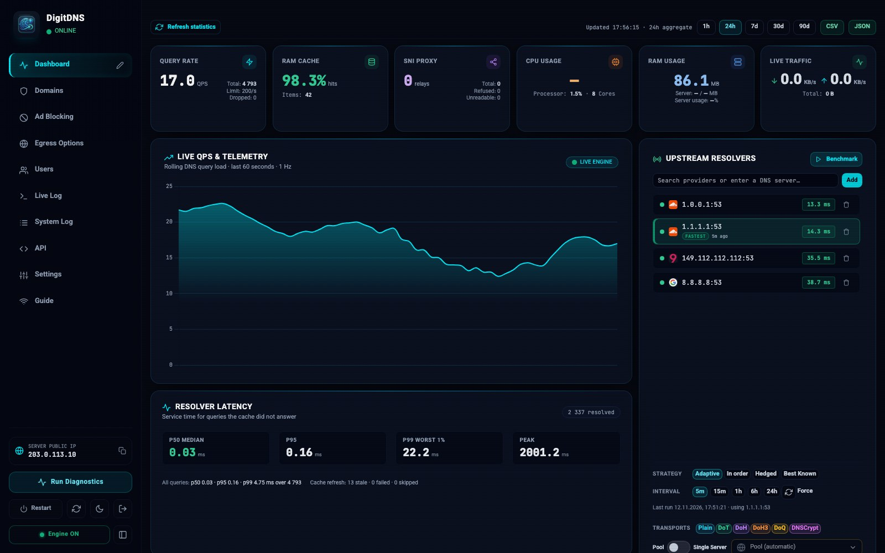
</p>

## What is DigitDNS?

DigitDNS is a self-hosted DNS server and SmartDNS resolver you run yourself. Point a phone, console, TV or router at one IP address and every lookup gets one of three answers: resolve normally, refuse it because it is an ad or a tracker, or send it through your server so the service sees the location you choose. There is no app to install on each device, no VPN tunnel and no account with someone else's cloud.

One static binary contains the resolver, the encrypted DNS listeners, the ad-blocking engine, the TLS/SNI relay, the web panel, the REST API, the subscriber portal and the updater. State lives in one encrypted database, one master key and one JSON config file. You can run it on a $5 VPS, a home server or a Raspberry Pi-sized box.

If you have looked at Pi-hole or AdGuard Home, DigitDNS covers the same ground — and adds an encrypted-DNS server, a subscriber panel and a TLS relay in the same install.

It is a fork of [HyperDNS](https://github.com/IzumiRain/HyperDNS) by HyperRAIN, maintained by [Digitrob](https://github.com/digitrob), free and open source under AGPL-3.0. Use it only on servers and networks you are allowed to operate.

> [!NOTE]
> **v5.8.2 is out.** It adds pictograms to the alert channels (web + Android), fixes the Android alert channel name collapse, and tightens the DNS hot path (lock-free upstream stats/order views, query-log settings cache) plus dashboard 1 Hz repaint. See the [changelog](docs/CHANGELOG.md) for every release.

## Why people use it

- **Block ads on every device.** One blocklist policy covers the whole network, with 45 curated lists, a recommended base and an always-allow list for the false positives.
- **Unblock without a VPN.** Only the names you mark as proxied go through the relay. Everything else keeps its direct path, including game traffic. TLS is forwarded byte-for-byte and never decrypted.
- **Encrypted DNS everywhere.** Serve DoT, DoH, DoH3, DoQ and DNSCrypt, validate DNSSEC yourself, and stop proxied names from leaking around the relay.
- **Built to share.** Users, quotas, expiry, device limits, a registration secret and a portal with setup guides for consoles, phones and routers. A native Android app is included.

## Features

### A dashboard that tells you what is happening

The dashboard is a live view, not a static report: query rate, cache hits, memory, CPU, relay connections, bandwidth, resolver latency percentiles and the current upstream pool.

- **Arrange it yourself.** Drag cards anywhere on a 12-column grid and resize them from any edge. The layout is stored on the server, so it follows you to another browser or device. On a phone, long-press a card to pick it up.
- **Three themes.** Dark, Grey and Light, with the choice remembered through login and restarts. Android also offers Follow system.
- **Engine ON/OFF.** Turn the whole rule engine off in one click: custom records, routing, proxying and ad blocking are bypassed and every query resolves normally. Access control and quotas stay enforced.
- **Live Log and System Log.** The live query log streams in with quick actions. The system log keeps the daemon's own tail in a bounded buffer, with copy and export.
- **First-run checklist.** The panel tells you what is still missing: password, 2FA, certificate, DNS listener, upstreams, first user.
- **Change previews.** Saving routing rules or ad-blocking settings shows a redacted before/after diff before a destructive change lands.
- **Diagnostics.** Probe your own targets, get a reachability score and per-target latency.

### Domains: proxy, block or direct

One Domains list holds proxied, paused, blocked and direct names, with status chips, search, sort and bulk selection.

- **Wildcard scopes you can see:** `exact` (host and subdomains), `*.host` (subdomains only) and `*.parent` (the parent's subtree). Changing a scope rewrites the rule in place and keeps its row position.
- **Policy groups** bundle domains into named, enable/disable-able sets with optional icons.
- **Services** are labels, not routing rules: group streaming, gaming or work domains, give each a name and icon, and filter the domain list by them. A service can also carry a default relay.
- **DNS Rewrites** map a hostname to a fixed IPv4 or IPv6 address, including bulk import.
- **Bulk import** accepts pasted or uploaded lists with `#` comments and `*.wildcards`.
- **Built-in direct routing** keeps a handful of high-bandwidth services (voice chat, game-store CDNs, OS update CDNs) off the relay.
- **Per-domain exit.** Send a domain through This Server, a named relay agent or Inherit. The choice can also come from its service default.

### Ad blocking

The DNS sink sits in front of upstream resolution and answers blocked names before they leave your network.

- **45 curated blocklists** in five groups: General protection, Supplementary ads & trackers, Malware/phishing/scams, Device & vendor telemetry, and Optional extras. Sources include HaGeZi Pro / Light / Pro+ / Ultimate, OISD Big / Small, AdGuard DNS, 1Hosts Xtra / Lite, StevenBlack Unified, Peter Lowe, AdAway, Dan Pollock, URLhaus and Phishing Army.
- **Install in one click.** A recommended base is marked, each preset shows its description, licence, warning, homepage and complete raw file, and its domain count is scanned in the background before you commit.
- **Custom lists.** Subscribe to any hosts or Adblock URL, or upload a local file. Downloads are capped at 64 MB, uploads at 16 MB, duplicate URLs are rejected and parsing runs off the DNS hot path.
- **Policy you control.** Enable/disable blocking, choose `0.0.0.0`, `NXDOMAIN` or `REFUSED`, set the block TTL and update interval, and keep an always-allow list that wins over every blocklist.
- **Active lists first.** Enabled lists are pinned to the top under an **ACTIVE** heading and removed from their catalogue groups, so what is actually blocking is the first thing you see.
- **Per-list lifecycle.** Toggle without deleting, update one list or all lists, refresh on the configured schedule (default 24 hours, checked every 15 minutes), delete, and see unique domains, rules, allow/skipped entries and the last update.
- **"Why was this blocked?"** The rule tester shows the action, the matching custom rule or blocklist source, the pattern and the egress, on web and Android.
- **API.** Full management through `/api/v3/filtering`.

### Encrypted DNS and privacy

Every client-facing transport lives in one place, with a port, endpoint, live listener status and its own switch.

| Transport | Where it listens | Notes |
| :--- | :--- | :--- |
| Plain DNS | 53/UDP + TCP | Can be disabled independently |
| DoT | 853/TCP | On by default when TLS is configured |
| DoH | 8443/TCP `/dns-query` | HTTP/2; can be disabled independently |
| DoH3 | 8443/UDP `/dns-query` | Opt-in; advertised over TCP DoH with `Alt-Svc` |
| DoQ | 853/UDP | Opt-in; RFC 9250, one query per stream |
| DNSCrypt | 5443/UDP + TCP | Opt-in; signed certificate and copyable stamp |

- **Authentication options.** DoH bearer tokens, DoT/DoQ SNI-token authentication (`tls://<token>.dot.example.com:853`, `quic://<token>.doq.example.com:853`) and mTLS with an operator-supplied client CA for DoT, DoH, DoH3 and DoQ.
- **DNSSEC validation.** Optional chain-of-trust validation with built-in IANA root anchors, DS/DNSKEY walking, NSEC/NSEC3 denial proofs, `AD` set only on answers this server validated, and `SERVFAIL` for bogus zones. `+cd` bypasses validation; cache entries are DNSSEC-aware so DO=0 clients never receive signature or denial records.
- **Proxy leak protection.** For proxied names, `HTTPS` and `SVCB` queries are answered locally with an empty answer, so a browser cannot learn the origin's QUIC capability or real addresses and bypass the relay. On by default, with an explicit opt-out.
- **IPv6 for proxied names.** Publish your own IPv6 globally or per relay agent. When it is off, proxied AAAA is withheld and agents stay IPv4-only, with no leak.
- **A cache that behaves.** RAM cache with minimum/maximum TTL bounds, serve-stale, live hit rate and a one-click flush.
- **Certificates built in.** Issue and renew the panel, DoH/DoT and subscriber-portal certificates with the embedded ACME client (HTTP-01), a Cloudflare DNS-01 wildcard, or bring your own PEM pair. No certbot, cron or restart required.

### Upstream resolvers

- **All the transports:** plain UDP/TCP, DoT, DoH, DoH3, DoQ and DNSCrypt upstreams, benchmarked from your server.
- **Adaptive (fastest) is the default strategy.** The pool is benchmarked on a 5 min / 15 min / 1 h / 6 h / 24 h schedule, the fastest healthy resolver is selected with 12% hysteresis, and the choice and last run are persisted. **Force** runs the same check immediately.
- **Other strategies:** In Order, Hedged (next resolver after 50 ms) and Best Known. **Single Server** pins one resolver and bypasses the pool.
- **Transport chips are real filters.** Plain, DoT, DoH, DoH3, DoQ and DNSCrypt can be enabled together; the pool only uses the selected protocols.
- **Provider presets.** Search a curated top-ten list of public DNS providers, grouped by provider with bundled logos and every supported transport, or type a custom address.
- **Health you can trust.** Warm-up probes, median latency, live p50/p95/p99, per-row health, a circuit breaker and a **FASTEST** badge. Top upstreams can be ranked by provider.
- **Per-domain overrides** from the Domains gear; failures fall back to the pool.

### Relay and egress

Domains marked as proxied resolve to your server. The device opens TLS to the server, which forwards the encrypted stream to the real host and back.

- **No decryption.** The relay never holds the session keys or the plaintext, and the destination sees your server's IP. Up to 4,096 concurrent relays, with optional TLS fragmentation for DPI resistance.
- **Geo relay agents.** A small agent in another country carries the encrypted stream. The hub still resolves the domain and enforces the client allowlist, so a box in a foreign datacentre holds no subscriber database and no panel credential. Agents need no domain or certificate, just a public IPv4, inbound TCP 80/443 and outbound HTTPS to the hub.
- **Full-instance relay mode.** A complete DigitDNS instance can act as a relay for another hub while continuing to serve its own clients. Hub traffic and local proxying share the same 80/443 listeners, hub clients only reach hosts the hub approves, and a cached catalogue keeps the relay working during a hub outage.
- **SOCKS5 and WireGuard egress.** Route the hub's outbound dial through a SOCKS5 proxy (remote DNS by default) or a userspace `wireguard-go` tunnel (paste or upload a `.conf`). Fail-closed is the default, and secrets are write-only.
- **One card layout.** Relay agents, SOCKS5 and WireGuard share the same status, traffic, last-seen, ping badge and **Test connection** card, refreshed every 10 seconds.
- **Routing order:** a domain override wins, then the service's default relay, then This Server.

### Users, quotas and the client portal

> The panel labels these accounts **Users**; the API and database keep the `client` resource name, so existing integrations are unchanged.

- **Per-user policy:** traffic quota, reset cycle, expiry, device limit, notes and policy set.
- **Whitelist mode by default.** Unknown source addresses are refused. Public Mode is an explicit switch, and a server-wide resolver allowlist can serve anonymous ranges.
- **Traffic metering** through the relay, persisted every 30 seconds, with quota and expiry enforcement.
- **Registration secret** lets a subscriber rebind their IP without an admin. The provisioning card gives you a copy-ready subscription link for Telegram or your own bot.
- **A private portal** at `https://your-server/sub/<token>`: Status (account, detected IP, traffic, quota, reset and expiry), Connect (every registered address plus DNS, DoH, DoT, DoQ and DoH3 endpoints) and Guide (complete setup steps for PlayStation, Xbox, Switch, Windows, iOS/macOS, Android and routers, using that subscription's live values).
- **Make it yours.** Use a separate portal domain and custom CSS; the Android app keeps saved subscriptions with one-tap reopen and **Switch to Admin**.

### Traffic history and monitoring

The optional 90-day aggregate store answers "what did this server see last week?" without retaining the queries themselves.

- **Five ranges:** 1h, 24h, 7d, 30d and 90d. The current hour is split into twelve five-minute buckets, 24h/7d read hourly buckets and 30d/90d read daily buckets.
- **Aggregate-only storage.** A separate `stats.db` holds counters and bounded top-N tables. The raw query log remains an in-memory ring and is never written to disk. Retention defaults to 90 days.
- **Six ranked tables:** domains, blocked domains, clients, upstreams, protocols and relay countries, with client names and relay flags.
- **Distinct clients with HyperLogLog.** An unbounded distinct count; older ranges fall back to `top-N approx.` only when they contain pre-HLL buckets.
- **Privacy controls.** HMAC-SHA256 client identifiers, a per-store salt and an opt-out for up to 500 IPs or account names.
- **Settings that stick.** Retention, top-N limits, anonymization and the client opt-out are edited under **Settings → Traffic History**. The store is opened at boot, so changes apply after a restart.
- **Exports and a sticky toolbar.** Refresh, range chips, CSV/JSON export, and a row that stays pinned while the cards scroll.
- **Prometheus and Grafana.** `GET /<admin-path>/api/metrics` covers the resolver, cache, relay, latency and the agent control plane. See [docs/METRICS.md](docs/METRICS.md) for scrape config, PromQL examples and an importable dashboard.
- **The same history on Android:** range switching, KPI tiles, the stacked chart and every ranked table.

### The Android app

The Android app is a native companion with the same control surface as the panel, plus the subscriber client area. It has its own version line (`android-v5.8.2`) and is side-loaded; it is not on Play.

- **Admin parity:** dashboard, Domains and wildcards, Users and quotas, Live Log, System Log, Egress Options, upstream resolvers and policies, encrypted transports, DNSSEC, proxy leak protection, IPv6, traffic history, ad blocking, relay agents, diagnostics, certificates, settings and server switching.
- **Client area:** account status, IP registration, traffic and expiry, every DNS endpoint, the setup guide for your device and saved subscriptions.
- **Phone and tablet:** bottom navigation on phones, NavigationRail at 600 dp and above, and a layout that fits without scrolling.
- **Biometric login:** require a fingerprint, face or device PIN to open the app, with device-PIN fallback and a sign-out escape.
- **Quick Settings tile** toggles ad blocking without opening the app.
- **Themes:** Follow system, Dark, Grey and Light. The choice is stored and applied at launch.

| APK | Architecture |
| :--- | :--- |
| `digitdns-arm64-v8a.apk` | 64-bit ARM — almost every phone since ~2016 |
| `digitdns-armeabi-v7a.apk` | 32-bit ARM — older devices |
| `digitdns-x86_64.apk` | Emulators and some tablets |
| `digitdns-universal.apk` | All of the above, larger |

Download from the [latest release](https://github.com/digitrob/DigitDNS/releases/latest) and verify against the matching `.sha256`. Requires **Android 10 (API 29)** or newer. A server update never forces an app update.

### API and automation

REST API v2 and v3 cover clients, domains, settings, resolution policy, upstreams, filtering, relay agents, egress, diagnostics and updates.

- Authenticate with a dashboard session or the master API key (`X-API-Key`).
- Contracts, payloads and Python/Node/cURL examples are in [docs/API.md](docs/API.md).
- Swagger is served from the panel at `/ADMIN_PATH/api/v3/docs`; the OpenAPI document is at `/api/v3/openapi.json`.
- The API binds to `127.0.0.1` by default; widen it deliberately.

## Screenshots

### Web panel

| Domains and routing | Ad blocking |
| :---: | :---: |
| 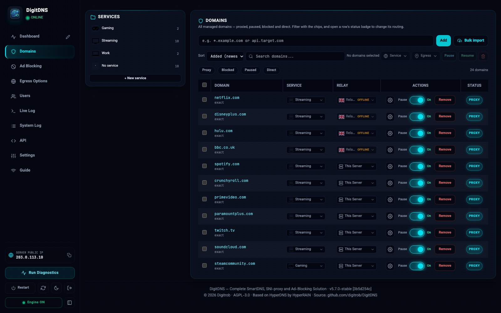 | 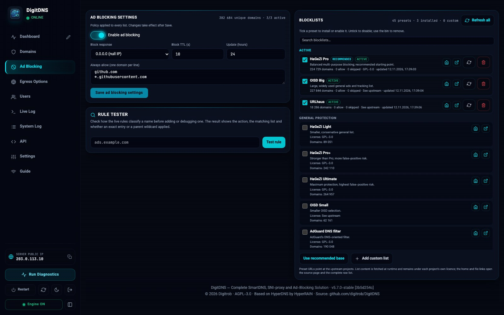 |

### Traffic history

The optional aggregate store keeps 90 days of counters and top tables, never the raw queries.

<p align="center">
  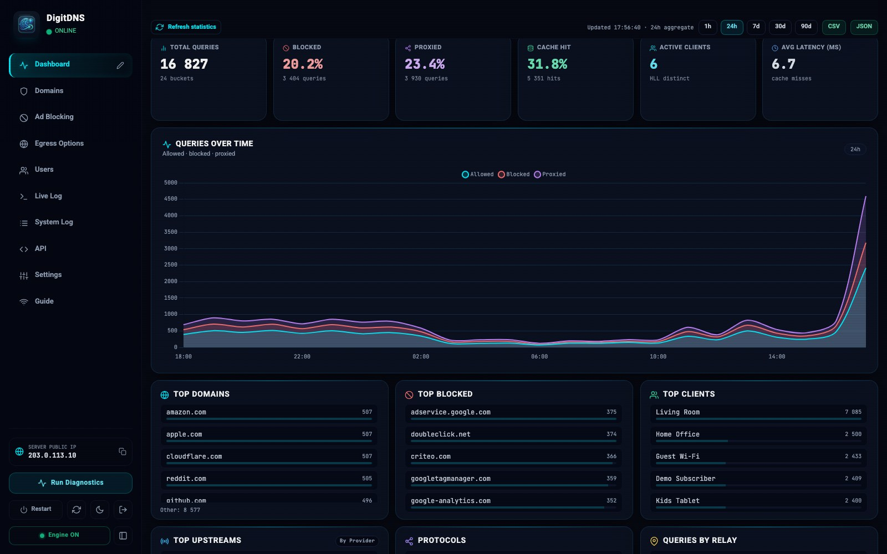
</p>

### Themes

Three themes, one panel. The choice is stored, survives login and restarts, and is applied before the first paint so there is no flash. Android adds **Follow system** alongside Dark, Grey and Light.

<p align="center">
  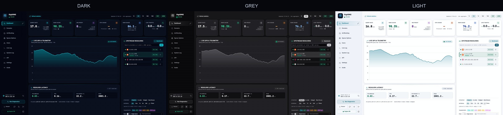
</p>

### Client portal

The subscriber portal is a private link with the account status, every DNS endpoint and a setup guide for the device in hand.

<p align="center">
  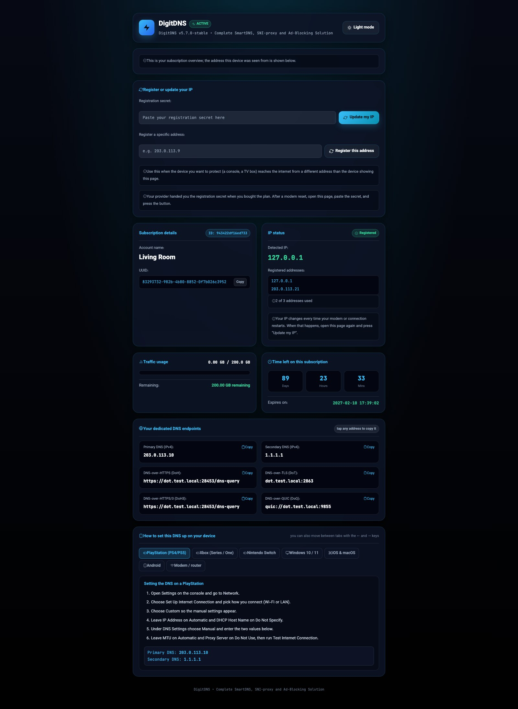
</p>

### Android

| Dashboard | Domains | Ad blocking | Users |
| :---: | :---: | :---: | :---: |
| 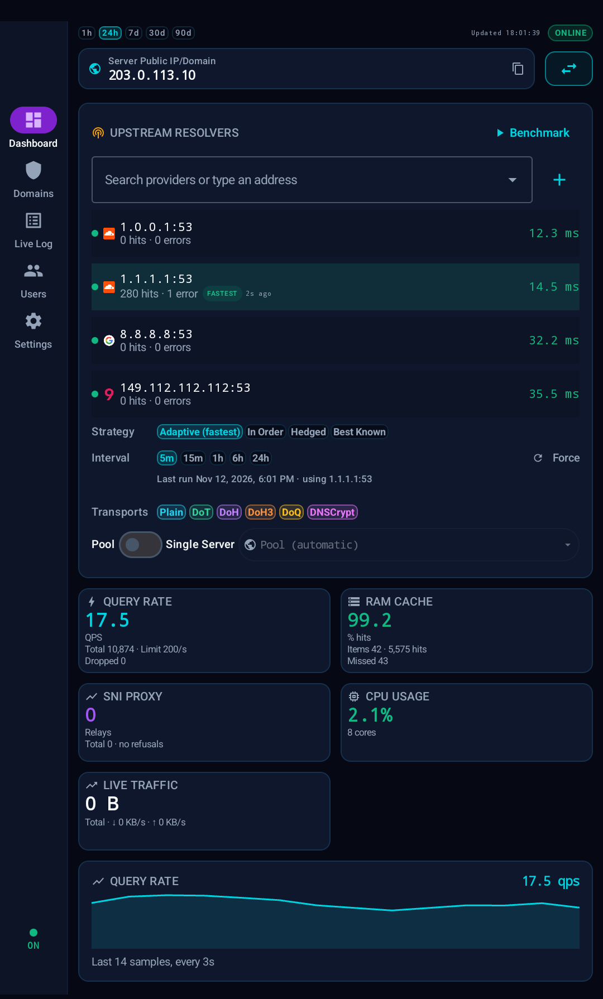 | 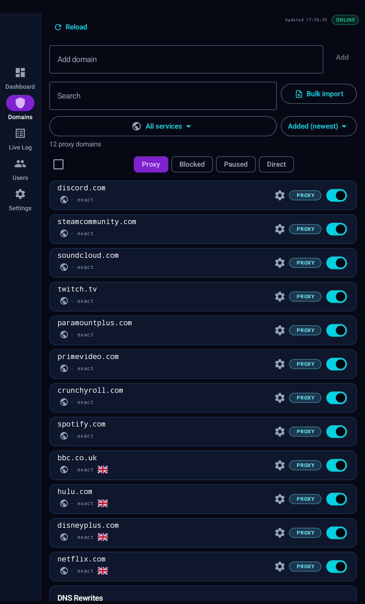 | 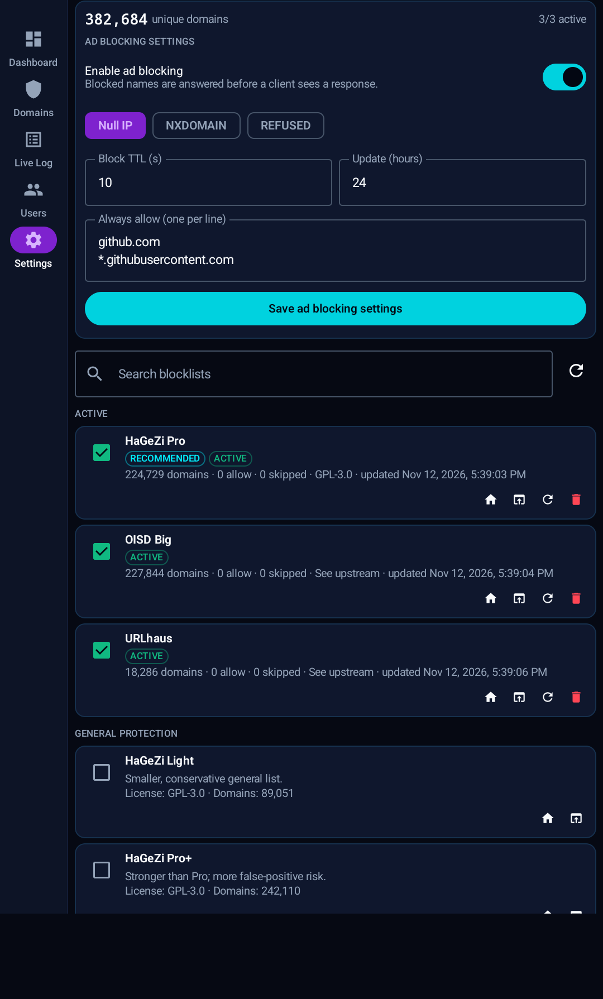 | 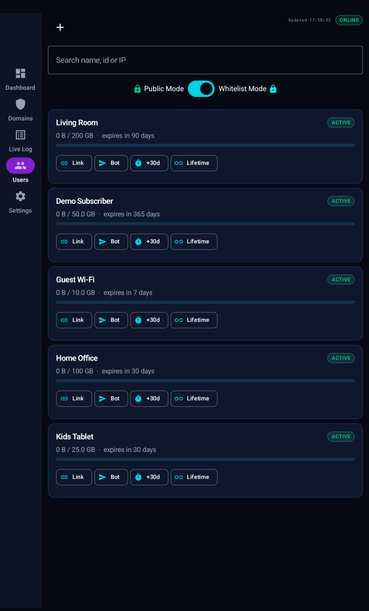 |

| Dark | Grey | Light | Theme settings |
| :---: | :---: | :---: | :---: |
|  | 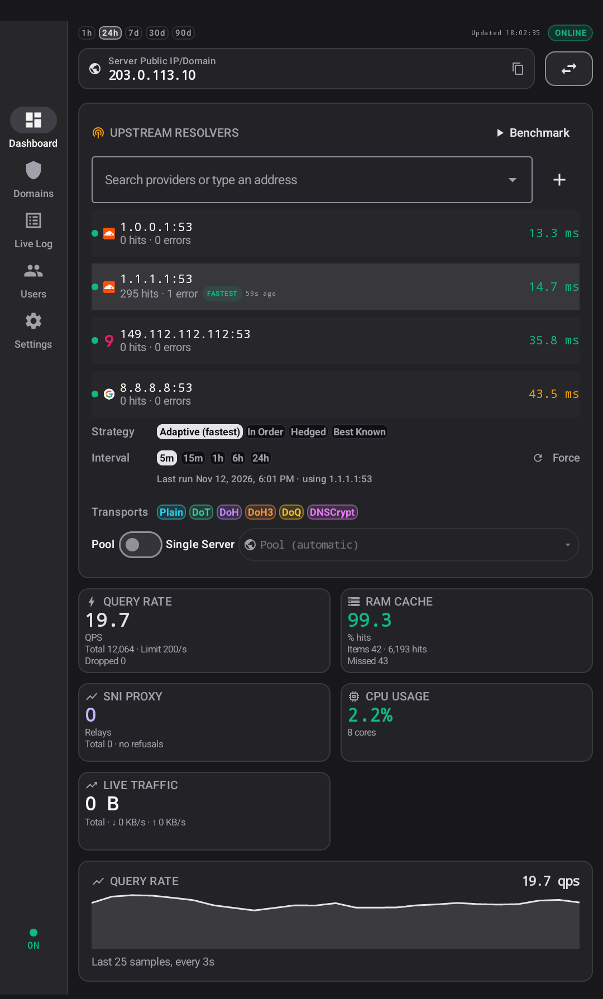 | 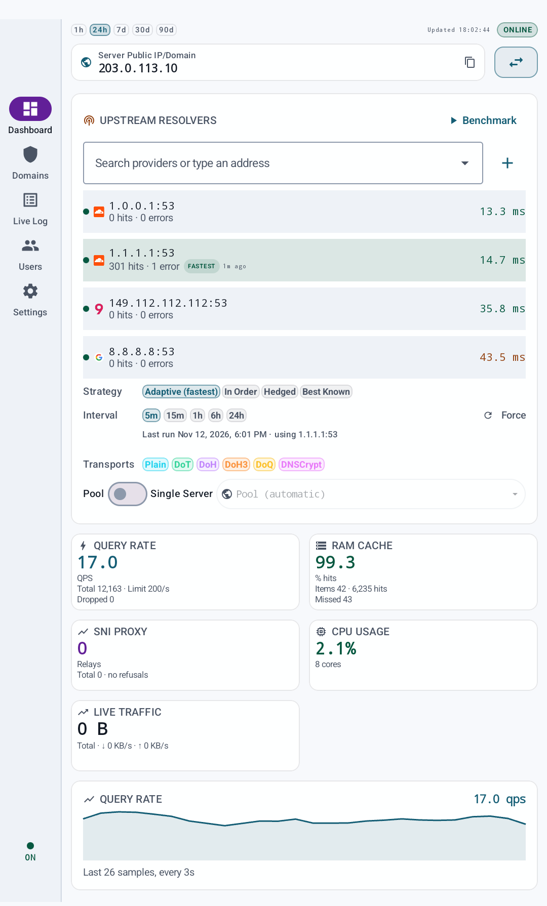 | 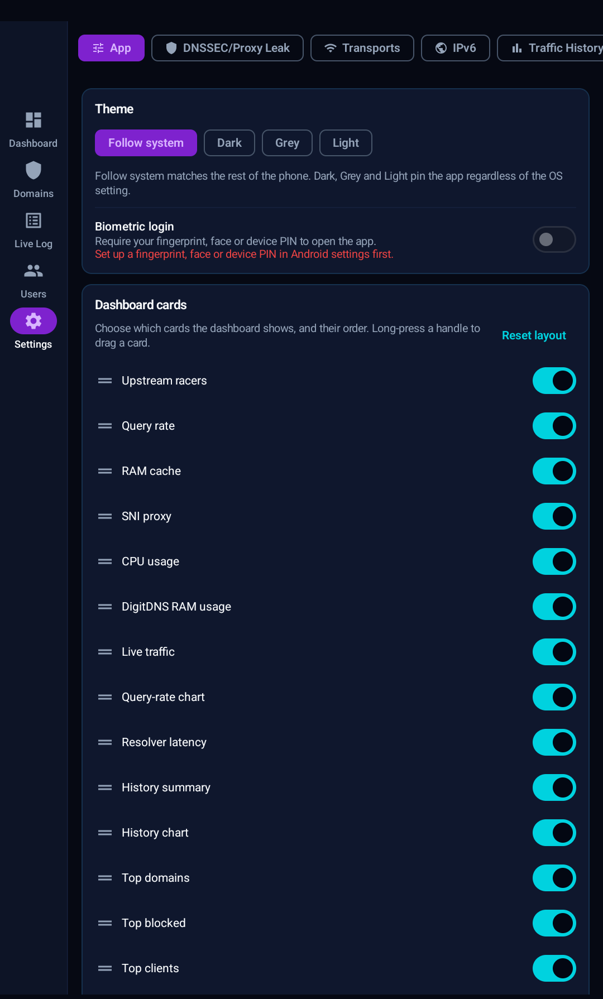 |

> Screenshots use a test server with documentation addresses. No real client names or public addresses are shown.

## Quick start

You need a Linux server (1 vCPU / 1 GB is enough for personal use), root access, and one hostname whose **A record points at the server**. The panel is HTTPS-only and obtains its own Let's Encrypt certificate, so the domain is not optional for a normal install.

```bash
curl -fsSL https://raw.githubusercontent.com/digitrob/DigitDNS/v5.8.2/scripts/install.sh | sudo bash
```

The installer sets up the service, firewall, certificate, admin password and a random panel port/path, then prints the login URL. Open it, sign in, and point a device at the server's IP on port 53 (UDP and TCP).

Verify from another machine:

```bash
dig @YOUR_SERVER_IP example.com A
```

> [!IMPORTANT]
> Save the admin password and back up `master.key` from the data directory. The key encrypts every subscriber record; without it the database cannot be read. See [Backup and restore](#backup-and-restore).

## Requirements

| | Minimum | Comfortable |
| :--- | :--- | :--- |
| CPU / RAM | 1 vCPU, 1 GB | 2 vCPU, 2 GB (~10 active subscribers) |
| Disk | 1 GB | 5 GB (logs, certificates, database growth) |
| OS | Ubuntu 20.04+, Debian 11+, AlmaLinux/Rocky 8+ (systemd) | Ubuntu 22.04+ / Debian 12+ |
| Network | A public IPv4; IPv6 optional | Static IP, port 80 reachable for ACME |
| Domain | One hostname → server A record | A second hostname for DoH/DoT is optional |

**Ports**

| Port | Protocol | Purpose |
| :--- | :--- | :--- |
| 53 | UDP + TCP | Plain DNS for clients |
| 80 | TCP | ACME HTTP-01 challenge and the HTTP relay |
| 443 | TCP | HTTPS relay for proxied domains |
| 853 | TCP | DNS-over-TLS (when TLS is configured) |
| 853 | UDP | DNS-over-QUIC (opt-in) |
| 8443 | TCP | DNS-over-HTTPS at `/dns-query` (when TLS is configured) |
| 8443 | UDP | DoH over HTTP/3 (opt-in) |
| 5443 | UDP + TCP | DNSCrypt (opt-in; avoids TCP 443, which the SNI proxy owns) |
| random 20000–60000 | TCP | Web dashboard; chosen at install and printed in the URL |

**Relay agent (optional)**

An agent needs a public IPv4, inbound TCP **80/443**, outbound HTTPS to the hub, and no domain or certificate. It is Linux amd64/arm64. The hub keeps all other requirements. Full manual: [docs/AGENT.md](docs/AGENT.md).

## Installation

### 1. One-line installer (Linux, recommended)

Interactive:

```bash
curl -fsSL https://raw.githubusercontent.com/digitrob/DigitDNS/v5.8.2/scripts/install.sh | sudo bash
```

Non-interactive:

```bash
DIGITDNS_DOMAIN=dns.example.com \
DIGITDNS_EMAIL=you@example.com \
bash install.sh
```

Optional environment variables:

| Variable | Meaning |
| :--- | :--- |
| `DIGITDNS_DOMAIN` | Panel hostname (must already point at the server) |
| `DIGITDNS_EMAIL` | Let's Encrypt account email |
| `DIGITDNS_PUBLIC_IP` | Override the detected public IPv4 |
| `DIGITDNS_FRESH=1` | Confirm a non-interactive fresh install / reinstall |

The installer supports amd64 and arm64, writes a systemd unit, opens the required firewall ports, installs `restore.sh` and `uninstall.sh`, and archives an existing install before upgrading it. Everything lives under `/opt/digitdns`.

**Offline install:** download `digitdns-offline-bundle.tar.gz` (or `.zip`) from the release page, copy it to the server, then run `install.sh` from the extracted directory. The offline bundle is Linux amd64; it needs internet only for the first certificate issuance.

### 2. Docker

Images are published for amd64 and arm64 and signed with cosign. The primary registry is GHCR: `ghcr.io/digitrob/digitdns` (hub) and `ghcr.io/digitrob/digitdns-agent` (optional relay agent). Docker Hub mirrors the same tags at `robmeister/digitdns` and `robmeister/digitdns-agent`.

```bash
docker pull ghcr.io/digitrob/digitdns:latest
# Docker Hub mirror:
# docker pull robmeister/digitdns:latest

mkdir -p data certs
docker run -d --name digitdns --network host \
  -v "$PWD/data:/app/data" -v "$PWD/certs:/app/certs" \
  -e TZ=UTC \
  ghcr.io/digitrob/digitdns:latest
```

Or with Compose:

```yaml
services:
  digitdns:
    image: ghcr.io/digitrob/digitdns:latest
    container_name: digitdns
    restart: always
    network_mode: "host"
    volumes:
      - ./data:/app/data
      - ./certs:/app/certs
    environment:
      - TZ=UTC
    ulimits:
      nofile: { soft: 65535, hard: 65535 }
```

Set `image: robmeister/digitdns:latest` instead if you prefer the Docker Hub mirror.

```bash
mkdir -p data certs && docker compose up -d
docker logs -f digitdns
```

**Host networking is required**, not a preference: the resolver must see real client addresses for whitelisting, subscriber recognition and rate limiting, and DNS/DoT/DoH are not simple `-p` mappings.

| Tag | Meaning |
| :--- | :--- |
| `latest` | Latest stable release |
| `5.8.2` | Current release |
| `edge` | Nightly build from `main` — not for production |

Every release also has its own immutable `vX.Y.Z` tag. See the [releases page](https://github.com/digitrob/DigitDNS/releases) for the full list.

Verify the image:

```bash
cosign verify ghcr.io/digitrob/digitdns:latest \
  --certificate-identity-regexp 'https://github.com/digitrob/DigitDNS/.github/workflows/docker.yml@' \
  --certificate-oidc-issuer https://token.actions.githubusercontent.com
```

The Docker Hub mirror carries the same signature and digest:

```bash
cosign verify docker.io/robmeister/digitdns:latest \
  --certificate-identity-regexp 'https://github.com/digitrob/DigitDNS/.github/workflows/docker.yml@' \
  --certificate-oidc-issuer https://token.actions.githubusercontent.com
```

### 3. Pre-built binary + systemd

Release binaries are Linux amd64 and arm64. Checksums are published as `checksums.txt` and signed as `checksums.sig`.

```bash
curl -fsSL -o digitdns \
  https://github.com/digitrob/DigitDNS/releases/download/v5.8.2/digitdns-linux-amd64
chmod +x digitdns
sudo install -m 0755 digitdns /opt/digitdns/digitdns
```

Use the canonical unit from `scripts/digitdns.service` (or adapt it):

```ini
[Unit]
Description=DigitDNS
After=network-online.target
Wants=network-online.target

[Service]
Type=simple
User=root
WorkingDirectory=/opt/digitdns
RuntimeDirectory=digitdns
RuntimeDirectoryMode=0700
ExecStart=/opt/digitdns/digitdns -daemon \
  -config /opt/digitdns/config.json \
  -db /opt/digitdns/data.db \
  -key /opt/digitdns/master.key
Restart=always
RestartSec=3s
LimitNOFILE=65535

[Install]
WantedBy=multi-user.target
```

Start with `./digitdns -server` on a fresh machine to generate the database, key, config and first-run credentials; the service runs `-daemon`.

### 4. Build from source

Requires Go 1.26+.

```bash
git clone https://github.com/digitrob/DigitDNS.git
cd DigitDNS
go build -ldflags="-s -w" -o bin/digitdns ./cmd/digitdns
./bin/digitdns -server
```

The Go daemon builds on other operating systems for development, but the installer, systemd unit and packaged binaries target Linux.

### 5. Android app

The companion APKs are attached to every release. See [The Android app](#the-android-app) for the architecture table and installation steps.

### 6. Relay agent (optional)

An agent is a second, much smaller process on a public IPv4 in the country you want to exit from. It needs no domain, certificate, database or panel; only outbound HTTPS to the hub and inbound TCP **80/443** for relayed traffic.

1. On the hub open **Egress Options → Relay Agents → Add agent**, choose the country, and copy the key shown after saving.
2. Run the container on the agent VPS:

```bash
mkdir -p /opt/digitdns-agent
docker run -d --name digitdns-agent --network host --restart unless-stopped \
  -v /opt/digitdns-agent:/data \
  ghcr.io/digitrob/digitdns-agent:latest \
  -hub 'https://panel.example.com:8080/ADMIN_PATH' \
  -key 'AGENT_ID:SECRET' \
  -listen :80,:443 \
  -state /data/agent-state.json
```

Host networking is required: the agent must see the real client address and bind 80/443 without port remapping. The `-hub` value is the same panel origin you use in a browser, including the hidden admin path.

3. Back on the hub, wait for the card to show **online**, press **Test connection**, then assign domains or a service default to the agent.

The full manual — binary and systemd install, every flag, key rotation, troubleshooting, sizing and security — is in [docs/AGENT.md](docs/AGENT.md).

### Migrating from HyperDNS

The installer detects `/opt/hyperdns`, archives it and migrates the data in place. For a HyperDNS 1.x install, run `migrate-from-v1.sh` from the offline bundle first.

## First run

On a fresh install the daemon generates:

- an admin password, printed **once**;
- a hidden 16-character admin path;
- a dashboard port between 20000 and 60000;
- `master.key`, `data.db` and `config.json` under `/opt/digitdns`.

The panel is at:

```
https://YOUR_DOMAIN:PANEL_PORT/ADMIN_PATH/login
```

The bare hostname intentionally shows nothing, so scanners cannot discover the panel. Bookmark the full URL.

**Where things live**

| Path | What it is |
| :--- | :--- |
| `/opt/digitdns/data.db` | Encrypted subscriber/rule database |
| `/opt/digitdns/master.key` | Key that decrypts the database — back this up |
| `/opt/digitdns/config.json` | Server, DNS, relay, access and TLS settings |
| `/opt/digitdns/certs/` | Certificates |
| `/opt/digitdns/backups/` | Archives created by the installer |

Run `digitdns` with no arguments over SSH for the text console: status, diagnostics, restart/stop, subscriber management, upstream benchmark, cache flush, panel port, API key rotation, admin recovery and uninstall.

## Manuals

### Set up your first user

1. Open the panel and go to **Users → Add New User**.
2. Give the account a name, a traffic limit and an expiry. Leave the IP list empty if the subscriber will register themselves.
3. Save. The card shows a **Reg Link**, a **Bot Card** and the registration secret.
4. Send the subscriber their private portal link. They open it, paste the registration secret and press **Update my IP**; the device is now allowed.
5. To connect a console or TV that cannot open the portal, press **Set IP Manually** on the card and add the address it uses to reach the internet.

Unknown addresses are refused while **Whitelist Mode** is on, which is the default.

### Connect a device

The subscriber portal's **Guide** tab has the exact steps for each platform. In short:

- **PlayStation:** Settings → Network → Set Up Internet Connection → Custom → DNS Settings → Manual.
- **Xbox:** Settings → General → Network settings → Advanced settings → DNS settings → Manual.
- **Switch:** System Settings → Internet → your network → Change Settings → DNS Settings → Manual.
- **Windows:** Settings → Network & Internet → your adapter → DNS server assignment → Manual.
- **iOS/macOS:** Wi-Fi → your network → Configure DNS → Manual, or install a DoH/DoT profile.
- **Android:** Private DNS for DoT, or the network's DNS settings for plain DNS.
- **Router:** set the LAN DNS server to the address shown in the portal; every device behind it inherits the policy.

Use the hostname for DoT/DoH, never a bare IP: the certificate must match the name.

### Turn on ad blocking

1. Open **Ad Blocking**.
2. Turn on **Enable ad blocking**.
3. Press **Use recommended base** (HaGeZi Pro) or install individual lists from the catalogue.
4. Pick the block response (`0.0.0.0`, `NXDOMAIN` or `REFUSED`), the block TTL and the update interval.
5. Add any false positives to **Always allow** and save.
6. Test a domain in the **Rule Tester** to see which list or custom rule matched.

Enabled lists are pinned under **ACTIVE** at the top; the catalogue stays below. Updates run in the background on the configured schedule.

### Proxy a domain and choose its exit

1. Add the name in **Domains** (for example `netflix.com` or `*.example.com`) and leave its status on **Proxy**.
2. Pick a scope: `exact` covers the host and its subdomains, `*.host` covers subdomains only, `*.parent` covers the parent's subtree.
3. Use the **Relay** column to choose **This Server**, a named relay agent, or **Inherit**.
4. To set a default for a group, give the domains a **Service** and set that service's default relay.
5. Test from a client: the name should resolve to your server, and the TLS connection should be relayed without a certificate warning.

### Add a relay agent

1. On the hub, open **Egress Options → Relay Agents → Add agent**, choose the country and copy the one-time key.
2. On the agent VPS, run the `docker run` command above with that key and the hub URL including the admin path.
3. Open TCP 80/443 on the agent and allow outbound HTTPS to the hub. No inbound admin port and no certificate are needed.
4. Wait for **online**, press **Test connection**, then assign domains or a service default.
5. Rotate the key from the card if it is ever exposed; update the agent and restart it.

Full details, flags and troubleshooting: [docs/AGENT.md](docs/AGENT.md).

### Update and back up

- **Panel:** Settings → Server Update checks for a signed release and installs it with a backup and restart.
- **Docker:** `docker compose pull && docker compose up -d` (or the Docker Hub mirror).
- **Binary:** replace `/opt/digitdns/digitdns`, then `systemctl restart digitdns`.
- **Installer:** rerun it; the existing install is archived first.

Back up before any upgrade:

```bash
sudo systemctl stop digitdns
sudo tar -czf /root/digitdns-backup-$(date +%F).tar.gz \
  -C /opt/digitdns data.db master.key config.json certs
sudo systemctl start digitdns
```

Keep the archive off the server. `master.key` must always travel with `data.db`.

## Operations

### Upgrade

- **Panel:** Settings → Server Update checks for a signed release and installs it with a backup and restart.
- **Docker:** `docker pull ghcr.io/digitrob/digitdns:latest && docker compose up -d` (or `docker pull robmeister/digitdns:latest` for the Docker Hub mirror).
- **Binary:** replace `/opt/digitdns/digitdns`, then `systemctl restart digitdns`.
- **Installer:** rerun it; the existing install is archived first.
- **Relay agents:** pull the new `ghcr.io/digitrob/digitdns-agent` image (or `robmeister/digitdns-agent` from Docker Hub, or replace the binary) and restart. `/data/agent-state.json` survives; it holds the agent key and last catalogue.

Back up before any upgrade. Database and config format changes are handled automatically, but `master.key` must travel with `data.db`.

### Backup and restore

Stop the service before copying the database for a consistent snapshot:

```bash
sudo systemctl stop digitdns
sudo tar -czf /root/digitdns-backup-$(date +%F).tar.gz \
  -C /opt/digitdns data.db master.key config.json certs
sudo systemctl start digitdns
```

Keep the archive off the server. Restore with the service stopped by putting the four items back, or use `scripts/restore.sh` for an archive produced by the uninstaller. Never restore an old `master.key` into a fresh database — it will not decrypt it.

### Logs

```bash
sudo journalctl -u digitdns -f          # systemd install
docker logs -f digitdns                 # hub container
docker logs -f digitdns-agent           # relay agent container
```

The panel's **System Log** shows the same daemon tail with copy and export.

### Troubleshooting

| Symptom | Check |
| :--- | :--- |
| Blank page or 404 at the hostname | You need the full hidden URL with the panel port and admin path |
| Certificate issuance fails | A record points at this server; port 80 is open; Let's Encrypt rate limits |
| `dig` times out | Port 53 UDP/TCP open in the firewall; the service is running |
| DNS works but sites do not | Ports 80/443 must be reachable for the relay |
| Subscriber shows "not registered" | Their current public IP differs; register it with the secret |
| Phone cannot use Private DNS | Use the hostname, not an IP; it needs a valid DoT certificate |
| Locked out of the panel | Run `digitdns` over SSH → **Emergency admin reset** |
| `master.key` lost | The database is unrecoverable; restore a backup |
| Agent card says offline | Check its heartbeat: outbound HTTPS to the hub, the key, and the hub URL including the admin path |
| Agent says empty host allowlist | No active proxied domain or service resolves to it; assign one and wait for the catalogue sync |
| Agent test connection fails | The advertised relay port is not reachable: open TCP 80/443 and check the agent is binding `:80,:443` |
| Agent card cannot copy the key | The key predates encrypted storage; use **Rotate key**, then copy the new one |

### Uninstall

```bash
sudo /opt/digitdns/scripts/uninstall.sh
```

The uninstaller archives data and offers a restore script. The TUI option **Uninstall DigitDNS** does the same.

## Security

- Save the generated admin password and enable **two-factor authentication**.
- Keep the hidden admin path and panel port private.
- Keep **Whitelist Mode** on. An open resolver is abused within hours.
- Back up `master.key` offline; it is the only way to read `data.db`.
- Expose only the ports you use. The dashboard does not need to be public if you reach it through a VPN or SSH tunnel.
- The API binds to `127.0.0.1` by default; widen it deliberately.
- Prefer encrypted client transports and mTLS or tokens where your devices support them.
- Release checksums are signed, Docker images are cosign-signed and the in-panel updater verifies signatures before installing.

Full threat model and hardening guide: [docs/SECURITY.md](docs/SECURITY.md).

## FAQ

**Do I need a domain?** For the panel and client DoT/DoH, yes — the panel is HTTPS-only and DoT/DoH need a trusted certificate. A pure DNS lab can run without one, but that is not the supported install path.

**Does it hide my IP from websites?** Proxied domains see your server's IP, not the client's. Direct domains see the client's own IP as usual. This is not a VPN.

**Can I share it with family or customers?** Yes — that is what users, quotas, expiry, device limits and the portal are for. Keep whitelist mode on.

**Does it work behind Cloudflare or another CDN?** No. DNS and the relay need direct access to the server's ports; a proxying CDN breaks both.

**Are Windows/macOS server binaries published?** No. The daemon builds from source on Go-supported systems, but release binaries, installers and the systemd unit target Linux.

**Is the Android app on Play Store?** No. Signed APKs are attached to each release and side-loaded.

**Will upgrades keep my data?** Yes; the schema is migrated automatically. Back up `data.db` and `master.key` first.

**Where is my dashboard layout stored?** In the encrypted database as a custom policy, not in the browser. It is shared by every browser that signs in to the same install.

## Documentation

| Document | Contents |
| :--- | :--- |
| [Tutorial](docs/TUTORIAL.md) | First boot, domain, first user, registration — start here |
| [Relay agents](docs/AGENT.md) | Install, operate and troubleshoot a geo agent |
| [API](docs/API.md) | REST v2/v3 with examples |
| [Security](docs/SECURITY.md) | Threat model, encryption, hardening, RFC notes |
| [Metrics](docs/METRICS.md) | Prometheus reference, PromQL and Grafana |
| [Changelog](docs/CHANGELOG.md) | Every release |
| [Releasing](docs/RELEASING.md) | Versioning and update channels |

Release channels: `latest` and plain `vX.Y.Z` releases are stable; `-beta` tags are prereleases and never take the *Latest* badge.

## Support

If DigitDNS helps you, you can support development:

| Method | Address |
| :--- | :--- |
| USDT (TRC20) | `TWrapnstisV3ZZsEgrfKDs2552SMc86VLE` |
| USDT (ERC20) | `0xd52Edf3767080cfE3E7037b9bAd2f9Aa7a8833C4` |
| TON | `UQBV9O4TlKdnrqVqsbPD83ClBE_POBHHXD-HFYqWnqhvWDo` |

If the project is useful, a star helps other people find it.

## License

AGPL-3.0, the same as the upstream project. This is a modified fork of **HyperDNS** by HyperRAIN ([github.com/IzumiRain/HyperDNS](https://github.com/IzumiRain/HyperDNS)); original copyright notices are retained. See [NOTICE](NOTICE) for attribution and a summary of changes.

Source: [github.com/digitrob/DigitDNS](https://github.com/digitrob/DigitDNS)
