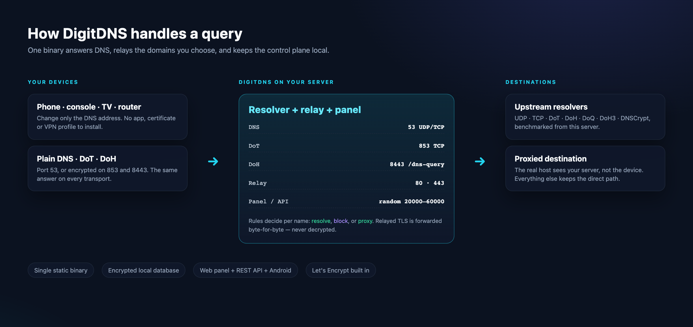
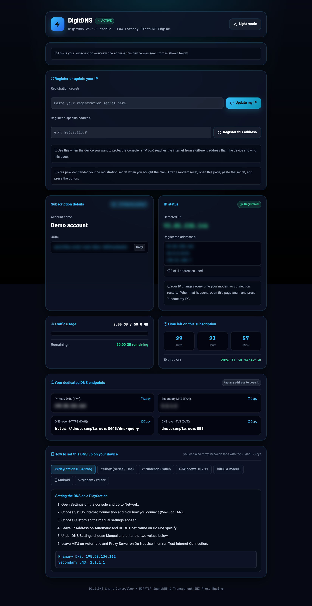
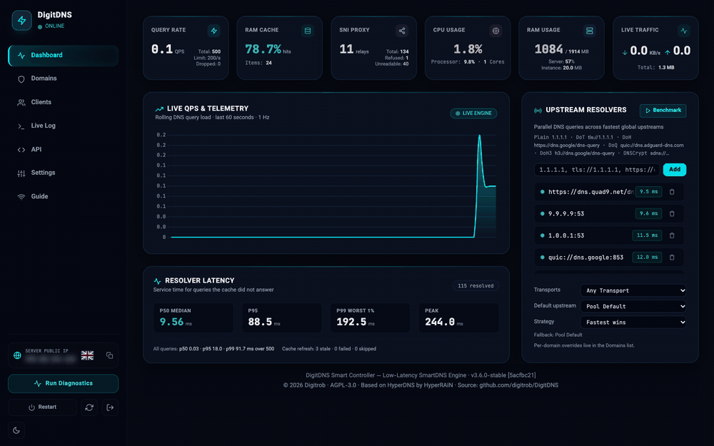
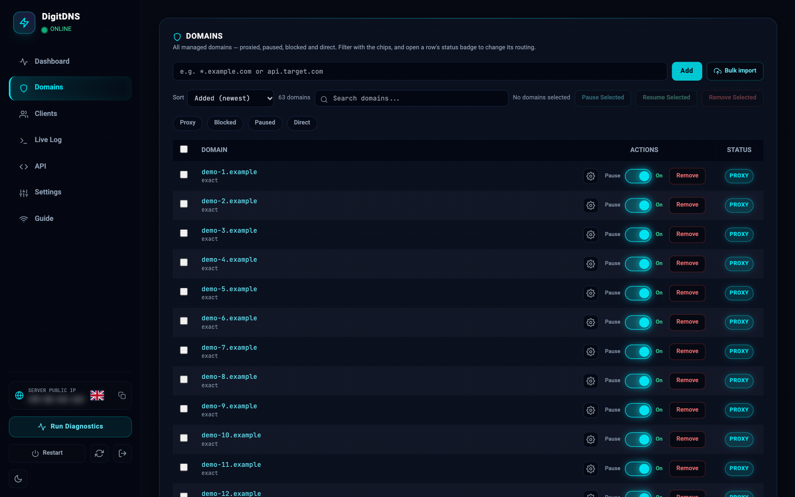
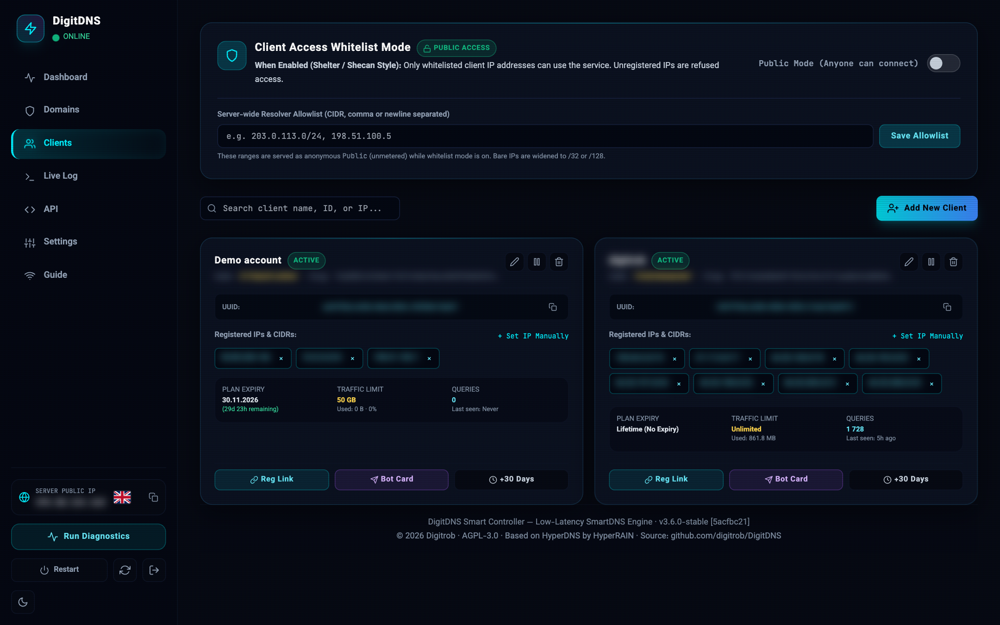
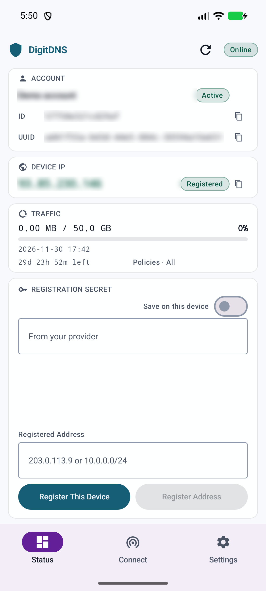
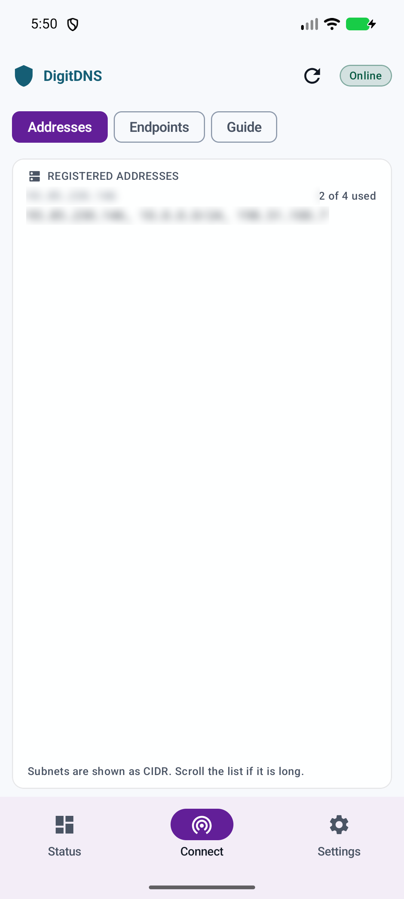

# ⚡ DigitDNS

[](https://github.com/digitrob/DigitDNS/releases/latest)
[](https://github.com/digitrob/DigitDNS/actions/workflows/ci.yml)
[](https://github.com/digitrob/DigitDNS/actions/workflows/android.yml)
[](https://github.com/digitrob/DigitDNS/actions/workflows/docker.yml)
[](LICENSE)

**A self-hosted smart DNS server, a TLS pass-through relay and a subscriber
panel in one static binary.** Point a phone, console, TV or router at it and
every domain gets one of three answers: resolve normally, refuse, or connect
through your server. The dashboard manages the rules, the subscribers, the
certificates and the upstream resolvers; a native Android app and a customer
portal give subscribers their own view.

Forked from [HyperDNS](https://github.com/IzumiRain/HyperDNS) by HyperRAIN and
maintained by [Digitrob](https://github.com/digitrob). Free, open source
(AGPL-3.0), no account, no cloud dependency — it runs on your own VPS or home
server. Use it only on servers and networks you are allowed to operate.

<p align="center">
  
</p>

<p align="center">
  <a href="#quick-start">🚀 Quick start</a> •
  <a href="#installation">📦 Install</a> •
  <a href="#features">🌟 Features</a> •
  <a href="#client-area">👤 Client area</a> •
  <a href="#android-app">📱 Android</a> •
  <a href="#operations">🔧 Operations</a> •
  <a href="#security">🛡️ Security</a> •
  <a href="#documentation">📚 Docs</a>
</p>

---

## Why DigitDNS

- **One binary, no runtime.** DNS, DoT, DoH, the TLS relay, the panel, the REST
  API, the subscriber portal and the self-updater are compiled into
  `digitdns`. The only state is a local encrypted database, a master key and a
  JSON config.
- **Rules per domain, not a mystery blocklist.** Proxy, block or route direct —
  with wildcard scopes you can see (`exact`, `*.host`, `*.parent`), named
  groups, bulk import and a single searchable Domains list.
- **A relay that never decrypts.** Proxied HTTPS is forwarded byte-for-byte;
  the server never holds the session keys or the plaintext.
- **Built for paying subscribers.** Per-client quotas, expiry, device limits,
  traffic accounting, a private portal link, a registration secret and an
  Android client area.
- **Encrypted DNS where it matters.** DoT and DoH for clients; DoT, DoH, DoQ,
  DoH3 and DNSCrypt for upstreams.

**What it is not:** a VPN. Only names you mark as proxied are relayed; all other
traffic keeps its direct path. It also does not hide your server's IP from the
destination of a proxied connection — that is the point of the relay.

<p align="center">
  
</p>

---

## Quick start

**You need:** a Linux server (1 vCPU / 1 GB is enough for personal use), root
access, and one hostname whose **A record points at the server**. The panel is
HTTPS-only and obtains its own Let's Encrypt certificate, so the domain is not
optional for a normal install.

```bash
curl -fsSL https://raw.githubusercontent.com/digitrob/DigitDNS/v3.6.1/scripts/install.sh | sudo bash
```

The installer sets up the service, firewall, certificate, admin password and a
random panel port/path, then prints the login URL. Open it, sign in, and point a
device at the server's IP on port 53 (UDP and TCP).

Verify from another machine:

```bash
dig @YOUR_SERVER_IP example.com A
```

> [!IMPORTANT]
> Save the admin password and back up `master.key` from the data directory.
> The key encrypts every subscriber record; without it the database cannot be
> read. See [Backup & restore](#backup--restore).

---

## Requirements

| | Minimum | Comfortable |
| :--- | :--- | :--- |
| CPU / RAM | 1 vCPU, 1 GB | 2 vCPU, 2 GB (~10 active subscribers) |
| Disk | 1 GB | 5 GB (logs, certificates, database growth) |
| OS | Ubuntu 20.04+, Debian 11+, AlmaLinux/Rocky 8+ (systemd) | Ubuntu 22.04+ / Debian 12+ |
| Network | A public IPv4; IPv6 optional | Static IP, port 80 reachable for ACME |
| Domain | One hostname → server A record | A second hostname for DoH/DoT is optional |

**Ports**

| Port | Protocol | Purpose |
| :--- | :--- | :--- |
| 53 | UDP + TCP | Plain DNS for clients |
| 80 | TCP | ACME HTTP-01 challenge and the HTTP relay |
| 443 | TCP | HTTPS relay for proxied domains |
| 853 | TCP | DNS-over-TLS (when TLS is configured) |
| 8443 | TCP | DNS-over-HTTPS at `/dns-query` (when TLS is configured) |
| random 20000–60000 | TCP | Web dashboard; chosen at install and printed in the URL |

DoQ, DoH3 and DNSCrypt are **upstream transports**, not client-facing
listeners. Clients use plain DNS, DoT or DoH.

---

## Installation

### 1. One-line installer (Linux, recommended)

Interactive:

```bash
curl -fsSL https://raw.githubusercontent.com/digitrob/DigitDNS/v3.6.1/scripts/install.sh | sudo bash
```

Non-interactive:

```bash
DIGITDNS_DOMAIN=dns.example.com \
DIGITDNS_EMAIL=you@example.com \
bash install.sh
```

Optional environment variables:

| Variable | Meaning |
| :--- | :--- |
| `DIGITDNS_DOMAIN` | Panel hostname (must already point at the server) |
| `DIGITDNS_EMAIL` | Let's Encrypt account email |
| `DIGITDNS_PUBLIC_IP` | Override the detected public IPv4 |
| `DIGITDNS_FRESH=1` | Confirm a non-interactive fresh install / reinstall |

The installer supports amd64 and arm64, writes a systemd unit, opens the
required firewall ports, installs `restore.sh` and `uninstall.sh`, and archives
an existing install before upgrading it. Everything lives under
`/opt/digitdns`.

**Offline install:** download `digitdns-offline-bundle.tar.gz` (or `.zip`) from
the release page, copy it to the server, then run `install.sh` from the
extracted directory. The offline bundle is Linux amd64; it needs internet only
for the first certificate issuance.

### 2. Docker

Images are published for amd64 and arm64 and signed with cosign.

```bash
docker pull ghcr.io/digitrob/digitdns:latest

mkdir -p data certs
docker run -d --name digitdns --network host \
  -v "$PWD/data:/app/data" -v "$PWD/certs:/app/certs" \
  -e TZ=UTC \
  ghcr.io/digitrob/digitdns:latest
```

Or with Compose:

```yaml
services:
  digitdns:
    image: ghcr.io/digitrob/digitdns:latest
    container_name: digitdns
    restart: always
    network_mode: "host"
    volumes:
      - ./data:/app/data
      - ./certs:/app/certs
    environment:
      - TZ=UTC
    ulimits:
      nofile: { soft: 65535, hard: 65535 }
```

```bash
mkdir -p data certs && docker compose up -d
docker logs -f digitdns
```

**Host networking is required**, not a preference: the resolver must see real
client addresses for whitelisting, subscriber recognition and rate limiting,
and DNS/DoT/DoH are not simple `-p` mappings.

| Tag | Meaning |
| :--- | :--- |
| `latest` | Latest stable release |
| `3.6.1` | A specific immutable release |
| `edge` | Nightly build from `main` — not for production |

Verify the image:

```bash
cosign verify ghcr.io/digitrob/digitdns:latest \
  --certificate-identity-regexp 'https://github.com/digitrob/DigitDNS/.github/workflows/docker.yml@' \
  --certificate-oidc-issuer https://token.actions.githubusercontent.com
```

### 3. Pre-built binary + systemd

Release binaries are Linux amd64 and arm64. Checksums are published as
`checksums.txt` and signed as `checksums.sig`.

```bash
curl -fsSL -o digitdns \
  https://github.com/digitrob/DigitDNS/releases/download/v3.6.1/digitdns-linux-amd64
chmod +x digitdns
sudo install -m 0755 digitdns /opt/digitdns/digitdns
```

Use the canonical unit from `scripts/digitdns.service` (or adapt it):

```ini
[Unit]
Description=DigitDNS
After=network-online.target
Wants=network-online.target

[Service]
Type=simple
User=root
WorkingDirectory=/opt/digitdns
RuntimeDirectory=digitdns
RuntimeDirectoryMode=0700
ExecStart=/opt/digitdns/digitdns -daemon \
  -config /opt/digitdns/config.json \
  -db /opt/digitdns/data.db \
  -key /opt/digitdns/master.key
Restart=always
RestartSec=3s
LimitNOFILE=65535

[Install]
WantedBy=multi-user.target
```

Start with `./digitdns -server` on a fresh machine to generate the database,
key, config and first-run credentials; the service runs `-daemon`.

### 4. Build from source

Requires Go 1.26+.

```bash
git clone https://github.com/digitrob/DigitDNS.git
cd DigitDNS
go build -ldflags="-s -w" -o bin/digitdns ./cmd/digitdns
./bin/digitdns -server
```

The Go daemon builds on other operating systems for development, but the
installer, systemd unit and packaged binaries target Linux.

### 5. Android app

The companion APKs are attached to every release. See
[Android app](#android-app) for the architecture table and installation steps.

### Migrating from HyperDNS

The installer detects `/opt/hyperdns`, archives it and migrates the data in
place. For a HyperDNS 1.x install, run `migrate-from-v1.sh` from the offline
bundle first.

---

## First run

On a fresh install the daemon generates:

- an admin password, printed **once**;
- a hidden 16-character admin path;
- a dashboard port between 20000 and 60000;
- `master.key`, `data.db` and `config.json` under `/opt/digitdns`.

The panel is at:

```
https://YOUR_DOMAIN:PANEL_PORT/ADMIN_PATH/login
```

The bare hostname intentionally shows nothing, so scanners cannot discover the
panel. Bookmark the full URL.

**Where things live**

| Path | What it is |
| :--- | :--- |
| `/opt/digitdns/data.db` | Encrypted subscriber/rule database |
| `/opt/digitdns/master.key` | Key that decrypts the database — back this up |
| `/opt/digitdns/config.json` | Server, DNS, relay, access and TLS settings |
| `/opt/digitdns/certs/` | Certificates |
| `/opt/digitdns/backups/` | Archives created by the installer |

Run `digitdns` with no arguments over SSH for the text console: status,
diagnostics, restart/stop, subscriber management, upstream benchmark, cache
flush, panel port, API key rotation, admin recovery and uninstall.

---

## Features

### Domains and routing

- One Domains list holds proxied, paused, blocked and direct names, with status
  chips, search, sort and bulk selection.
- **Wildcard scopes you can see:** `exact` (host and subdomains), `*.host`
  (subdomains only), `*.parent` (the parent's subtree). Changing a scope
  rewrites the rule in place and keeps its row position.
- **Groups** bundle domains into named, enable/disable-able sets with optional
  icons.
- **Bulk import** accepts pasted or uploaded lists with `#` comments and
  `*.wildcards`.
- Built-in direct routing keeps a handful of high-bandwidth services
  (voice chat, game-store CDNs, OS update CDNs) off the relay.

### Proxy relay

Domains marked as proxied resolve to your server. The device opens TLS to the
server, which forwards the encrypted stream to the real host and back. No
decryption, no certificate substitution, up to 4,096 concurrent relays, with
optional TLS fragmentation for DPI resistance.

### Subscribers and quotas

- Per-client traffic quota, reset cycle, expiry, device limit, notes and policy
  set.
- Whitelist mode by default: unknown source addresses are refused.
- Per-client traffic is metered through the relay and persisted every 30
  seconds.
- Registration secret lets a subscriber rebind their IP without an admin.
- Copy-ready provisioning card and subscription link for Telegram or your own
  bot.

### Client area

A subscriber gets a private link (`https://your-server/sub/<token>`) and, on
Android, the same surface natively:

<p align="center">
  
</p>

- **Status** — account state, detected IP, traffic, quota, reset and expiry;
  Registration Secret and Registered Address controls at the bottom.
- **Connect** — every registered address and subnet, plus DNS, DoH and DoT
  endpoints with copy buttons.
- **Guide** — complete setup steps for PlayStation, Xbox, Switch, Windows,
  iOS/macOS, Android and routers, using the live values for that subscription.
- **Saved subscriptions** — the app keeps a subscription with its account name
  above the admin servers, with one-tap reopen and **Switch to Admin**.

### Encrypted DNS

| Transport | Direction | Where |
| :--- | :--- | :--- |
| DoT | Clients and upstreams | Client listener on 853; upstream `tls://host` |
| DoH | Clients and upstreams | Client listener on 8443 `/dns-query`; upstream `https://host/dns-query` |
| DoQ | Upstreams | `quic://host` |
| DoH3 | Upstreams | `h3://host/dns-query` |
| DNSCrypt | Upstreams | `sdns://…` stamp |

Client DoT/DoH need a valid certificate, so they require a domain. The server
keeps upstream connections alive between queries to cut handshake latency.

### Upstream resolvers and policy

- Plain UDP/TCP, DoT, DoH, DoQ, DoH3 and DNSCrypt upstreams, benchmarked live
  from your server.
- Global **Default upstream**, **Strategy** and **Transports** policy.
- Strategies: **Fastest Wins**, **In Order**, **Hedged** (next resolver after
  50 ms) and **Best Known** (fastest measured, then latency order on failure).
- Transport policies: **Any Transport**, **Encrypted Only**, **Regular DNS** —
  enforced, not advisory.
- Per-domain overrides from the Domains gear; failures fall back to the pool.

### Certificates, dashboard and diagnostics

- Embedded ACME client: issues and renews the panel certificate, plus an
  optional DoH/DoT certificate, without certbot or cron.
- Live dashboard: QPS, cache hits, memory, CPU, relay counts, traffic, latency
  percentiles and a rolling live query log with search, filters and quick
  actions.
- Diagnostics with operator-defined targets, a reachability score and per-target
  latency.
- Server location from a self-updating GeoIP database, and in-panel update
  checks with signature verification.
- REST API v2/v3 with Swagger docs at
  `https://YOUR_DOMAIN:PANEL_PORT/ADMIN_PATH/api/v3/docs`.

---

## A look at it

<p align="center">
  
</p>

| Domains | Clients |
| :---: | :---: |
|  |  |

## Android app

A native companion with the same control surface as the panel, on its own
version line (`android-v3.6.1`). Side-load it; it is not on Play.

| APK | Architecture |
| :--- | :--- |
| `digitdns-arm64-v8a.apk` | 64-bit ARM — almost every phone since ~2016 |
| `digitdns-armeabi-v7a.apk` | 32-bit ARM — older devices |
| `digitdns-x86_64.apk` | Emulators and some tablets |
| `digitdns-universal.apk` | All of the above, larger |

Download from the [latest release](https://github.com/digitrob/DigitDNS/releases/latest)
and verify against the matching `.sha256`. Requires **Android 10 (API 29)** or
newer.

It covers the dashboard, Domains and wildcards, Clients and quotas, the live
query log with quick actions, upstream resolvers and policies, diagnostics,
certificates, settings, server switching (multiple saved servers, saved
credentials, API keys with an optional **Save key** tick) and the subscriber
client area. Login supports password + TOTP and master API keys.

The app keeps its own version, so a server update never forces an app update.

<p align="center">
  
  &nbsp;&nbsp;
  
</p>


---

## Operations

### Upgrade

- **Panel:** Settings → Server Update checks for a signed release and installs
  it with a backup and restart.
- **Docker:** `docker pull ghcr.io/digitrob/digitdns:latest && docker compose up -d`.
- **Binary:** replace `/opt/digitdns/digitdns`, then `systemctl restart digitdns`.
- **Installer:** rerun it; the existing install is archived first.

Back up before any upgrade. Database and config format changes are handled
automatically, but `master.key` must travel with `data.db`.

### Backup & restore

Stop the service before copying the database for a consistent snapshot:

```bash
sudo systemctl stop digitdns
sudo tar -czf /root/digitdns-backup-$(date +%F).tar.gz \
  -C /opt/digitdns data.db master.key config.json certs
sudo systemctl start digitdns
```

Keep the archive off the server. Restore with the service stopped by putting
the four items back, or use `scripts/restore.sh` for an archive produced by the
uninstaller. Never restore an old `master.key` into a fresh database — it will
not decrypt it.

### Logs

```bash
sudo journalctl -u digitdns -f          # systemd install
docker logs -f digitdns                 # container
```

### Troubleshooting

| Symptom | Check |
| :--- | :--- |
| Blank page or 404 at the hostname | You need the full hidden URL with the panel port and admin path |
| Certificate issuance fails | A record points at this server; port 80 is open; Let's Encrypt rate limits |
| `dig` times out | Port 53 UDP/TCP open in the firewall; the service is running |
| DNS works but sites do not | Ports 80/443 must be reachable for the relay |
| Subscriber shows "not registered" | Their current public IP differs; register it with the secret |
| Phone cannot use Private DNS | Use the hostname, not an IP; it needs a valid DoT certificate |
| Locked out of the panel | Run `digitdns` over SSH → **Emergency admin reset** |
| `master.key` lost | The database is unrecoverable; restore a backup |

### Uninstall

```bash
sudo /opt/digitdns/scripts/uninstall.sh
```

The uninstaller archives data and offers a restore script. The TUI option
**Uninstall DigitDNS** does the same.

---

## Security

- Save the generated admin password; enable **two-factor authentication**.
- Keep the hidden admin path and panel port private.
- Keep **whitelist mode** on. An open resolver is abused within hours.
- Back up `master.key` offline; it is the only way to read `data.db`.
- Expose only the ports you use. The dashboard does not need to be public if
  you reach it through a VPN or SSH tunnel.
- The API binds to `127.0.0.1` by default; widen it deliberately.
- Release checksums are signed, Docker images are cosign-signed and the
  in-panel updater verifies signatures before installing.

Full threat model and hardening guide: [docs/SECURITY.md](docs/SECURITY.md).

---

## API & automation

REST API v2 and v3 cover clients, domains, settings, resolution policy,
upstreams, diagnostics and updates. Authenticate with a dashboard session or the
master API key (`X-API-Key`). Contracts, payloads and Python/Node/cURL examples:
[docs/API.md](docs/API.md). Swagger is served from the panel at
`/ADMIN_PATH/api/v3/docs`.

---

## FAQ

**Do I need a domain?** For the panel and client DoT/DoH, yes — the panel is
HTTPS-only and DoT/DoH need a trusted certificate. A pure DNS lab can run
without one, but that is not the supported install path.

**Does it hide my IP from websites?** Proxied domains see your server's IP, not
the client's. Direct domains see the client's own IP as usual. This is not a
VPN.

**Can I share it with family or customers?** Yes — that is what clients,
quotas, expiry, device limits and the portal are for. Keep whitelist mode on.

**Does it work behind Cloudflare or another CDN?** No. DNS and the relay need
direct access to the server's ports; a proxying CDN breaks both.

**Are Windows/macOS server binaries published?** No. The daemon builds from
source on Go-supported systems, but release binaries, installers and the
systemd unit target Linux.

**Is the Android app on Play Store?** No. Signed APKs are attached to each
release and side-loaded.

**Will upgrades keep my data?** Yes; the schema is migrated automatically. Back
up `data.db` and `master.key` first.

---

## Documentation

| Document | Contents |
| :--- | :--- |
| [Tutorial](docs/TUTORIAL.md) | First boot, domain, first client, registration — start here |
| [Security](docs/SECURITY.md) | Threat model, encryption, hardening, RFC notes |
| [API](docs/API.md) | REST v2/v3 with examples |
| [Changelog](docs/CHANGELOG.md) | Every release |
| [Releasing](docs/RELEASING.md) | Versioning and update channels |

Release channels: `latest` and untagged `vX.Y.Z` releases are stable; `-beta`
tags are prereleases and never take the *Latest* badge.

---

## Support

If DigitDNS helps you, you can support development:

| Method | Address |
| :--- | :--- |
| USDT (TRC20) | `TWrapnstisV3ZZsEgrfKDs2552SMc86VLE` |
| USDT (ERC20) | `0xd52Edf3767080cfE3E7037b9bAd2f9Aa7a8833C4` |
| TON | `UQBV9O4TlKdnrqVqsbPD83ClBE_POBHHXD-HFYqWnqhvWDo` |

---

## License

AGPL-3.0, the same as the upstream project. This is a modified fork of
**HyperDNS** by HyperRAIN ([github.com/IzumiRain/HyperDNS](https://github.com/IzumiRain/HyperDNS));
original copyright notices are retained. See [NOTICE](NOTICE) for attribution
and a summary of changes.

Source: [github.com/digitrob/DigitDNS](https://github.com/digitrob/DigitDNS)
