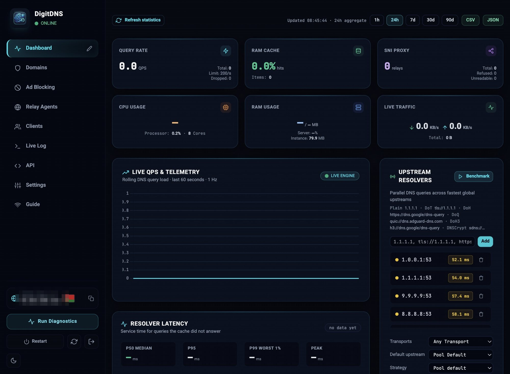
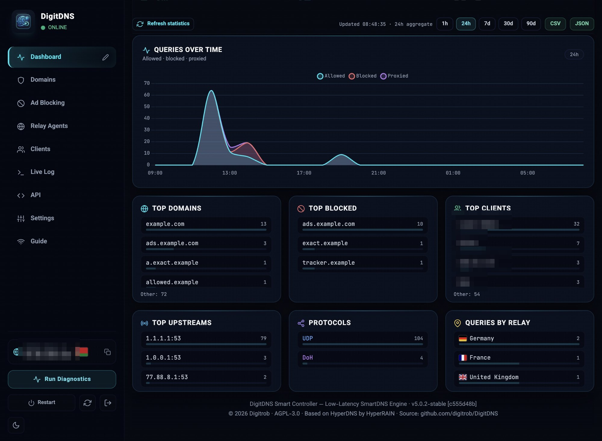
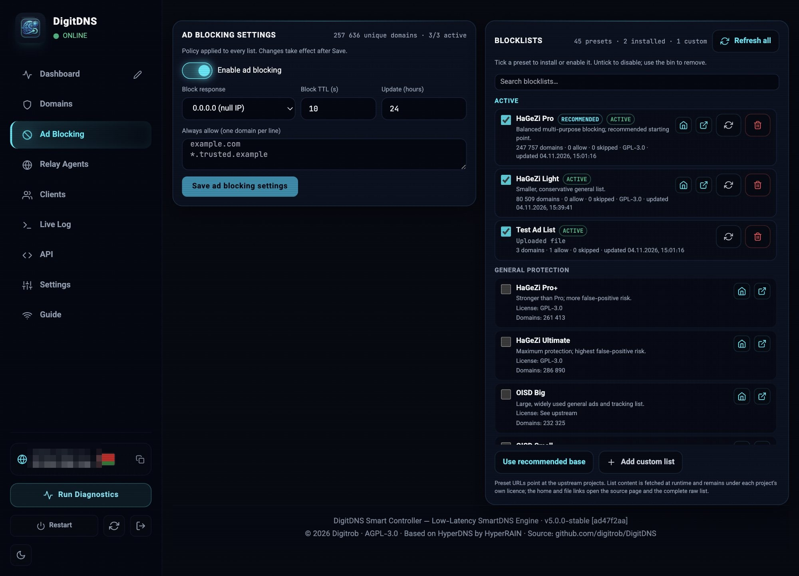
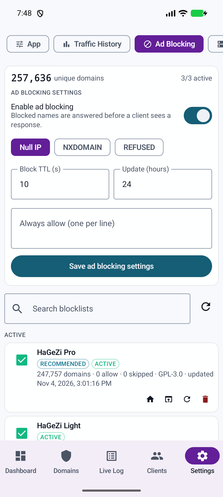

# DigitDNS v5.0.0 — One DNS stack: resolver, SNI relay, and ad blocking

**DigitDNS is now a fully featured solution that includes a DNS server, an SNI
proxy with relay agents, and a DNS sink with ad-blocking capabilities. One
solution gets you covered: DNS resolution, geo-blocking bypass and ad blocking —
without bolting on a second Pi-hole, a separate proxy or another dashboard.**

This is the largest feature release since the DigitDNS fork. The resolver, the
encrypted TLS relay and the subscriber panel now sit beside a real blocklist
engine and a long-window statistics store, all in the same static binary and the
same admin UI.

---

## 🛡️ A real ad-blocking engine, not a rules checkbox

The new **Ad Blocking** tab (web) and **Settings → Ad Blocking** screen (Android)
turn DigitDNS into a DNS sink. Blocked names are answered before a client ever
sees an upstream response.

### Built-in blocklist catalogue

- **45 curated presets** in five groups: General protection, Supplementary ads &
  trackers, Malware/phishing/scams, Device & vendor telemetry, and Optional
  extras.
- Well-known sources including **HaGeZi Pro / Light / Pro+ / Ultimate**, **OISD
  Big / Small**, **AdGuard DNS filter**, **1Hosts Xtra / Lite**, **StevenBlack
  Unified**, **Peter Lowe**, **AdAway**, **Dan Pollock**, **URLhaus**,
  **Phishing Army** and more.
- Each preset carries its description, licence, warning (where relevant), source
  homepage and complete raw file link. A recommended base list is marked and can
  be installed in one action.
- **Active lists are pinned to the top** under an **ACTIVE** heading on both web
  and Android, so the lists actually in force are the first thing you see. They
  are removed from their catalogue groups to avoid duplicate rows.
- Per-list **ACTIVE / DISABLED** badges, checkboxes to enable or disable, update
  and delete actions, plus the source and licence links.

### Custom lists and imports

- Add any **hosts or Adblock-format URL** as a subscription.
- **Upload** a local hosts/Adblock file when the list is not published at a URL.
- Duplicate URLs are rejected; names are bounded to 80 characters.
- Downloads are capped at 64 MB and uploads at 16 MB, parsed off the DNS hot
  path and installed atomically into the matcher.
- Background refreshes run on the configured interval (default 24 hours) with a
  15-minute due check. **Refresh all** and per-list update are available without
  restarting the daemon.

### Policy and visibility

- **Block response:** `0.0.0.0` (null IP), `NXDOMAIN`, or `REFUSED`.
- **Block TTL**, **update interval** and an **always-allow list** (one domain per
  line, wildcards supported). The allowlist wins over every blocklist.
- Live counts for **unique domains**, rules, allow entries, skipped entries and
  last update; the header shows unique domains and `active/total` lists.
- Preset counts are scanned in the background for lists you have not installed,
  so you can compare sizes before adding them.
- Disabling a list keeps it installed; the bin removes it entirely.
- Changes are persisted in the existing encrypted database and survive restarts.

### API

The engine is available to automation through the v3 surface:

```text
GET    /api/v3/filtering
GET    /api/v3/filtering/presets
POST   /api/v3/filtering/presets          # install preset IDs
POST   /api/v3/filtering/settings         # enabled, mode, TTL, interval, allowlist
POST   /api/v3/filtering/refresh
POST   /api/v3/filtering/lists            # URL or uploaded content
PATCH  /api/v3/filtering/lists/{id}       # enable / disable
POST   /api/v3/filtering/lists/{id}/update
DELETE /api/v3/filtering/lists/{id}
```

---

## 📊 Aggregated statistics that now draw properly

The history store keeps counters, never raw queries. This release makes the
short window genuinely useful and gives the whole dashboard a faster control
strip.

- **1h, 24h, 7d, 30d and 90d** ranges.
- **1h is sampled in real 5-minute buckets.** The current hour is split into
  twelve slices, so the graph has 10–12 drawable points as the hour progresses
  instead of a single dot. 24h and 7d read hourly buckets; 30d and 90d read daily
  buckets.
- Hourly buckets roll into daily history; daily retention defaults to 90 days.
- Six ranked tables: domains, blocked domains, clients, upstreams, protocols and
  relay countries.
- HyperLogLog client registers give a distinct-client count that is not clipped
  by the top-N table. Pre-HLL ranges say `top-N approx.`.
- Client privacy: optional HMAC-SHA256 client identifiers, per-store salt, and
  per-client opt-out by IP or account name.
- **CSV and JSON export** for the selected range, now coloured as actions and
  pinned to the far right of the toolbar.
- Sticky history toolbar: refresh on the left, status, range chips in the middle
  and exports on the right. It stays reachable while cards scroll underneath.
- History cards participate in the same free-placement layout editor as the live
  cards.

---

## 🧩 Free dashboard layout

- Cards can be placed freely on a **12-column, 12-pixel-row grid**, moved across
  the metrics, main and history grids, and resized from any edge or corner.
- Collision-safe drops, saved layout version 3 with automatic migration from the
  previous layout, and a reset action beside the edit control.
- Responsive KPI cards: the six live cards no longer clip their number columns
  at narrow widths; CPU, traffic and export controls wrap or reflow instead.
- History controls stay outside every draggable grid, so the editor cannot move
  or delete them.

---

## 📱 Android 5.0.0

- **Range chips moved into the top header**, in line with the Online badge, with
  the aggregate update clock beside them.
- **No timestamp flashing:** background history polls keep the last clock instead
  of briefly replacing it with “Loading…”.
- The same updated clock is shown in the same place on the other live-backed
  screens (Live Log, Clients, Proxied domains).
- **1h 5-minute chart** and a single-bucket bar fallback when only one slice has
  started.
- **Y-axis values and gridlines** on the Queries over time card.
- **Summary card is two rows of three** metrics, with tighter labels and values.
- **Ad Blocking screen** with the full preset catalogue, custom URL and file
  upload, active-first lists, green active states, refresh/update/delete and the
  same policy controls as the web panel.
- Existing subscriber, live log, relay agent and settings flows are unchanged.

---

## 🧭 The complete solution

DigitDNS now covers the three jobs that usually need three products:

1. **DNS resolution** — recursive resolution, cache, DoT, DoH, DoQ, DoH3 and
   DNSCrypt upstreams, per-domain rules, client quotas and a subscriber portal.
2. **Geo-blocking bypass** — an SNI-aware TLS pass-through relay with relay
   agents in other countries. The server never decrypts proxied traffic.
3. **Ad blocking** — a DNS sink with curated and custom blocklists, allowlists,
   update scheduling and per-list control.

One binary, one panel, one database, one Android companion.

---

## 📸 Screenshots

Web dashboard — live metrics, 1h aggregate, range chips and exports:

<p align="center">
  
</p>

Web history — the 1h range drawn from 5-minute buckets:

<p align="center">
  
</p>

Web ad blocking — active lists pinned first, 45 presets, policy and allowlist:

<p align="center">
  
</p>

Android — range chips and updated clock in the top header:

<p align="center">
  
</p>

Android — compact three-column summary and the 1h chart with a numeric axis:

<p align="center">
  
</p>

Android — ad blocking with active lists first:

<p align="center">
  
</p>

> Screenshots use a test server. The public address and one client name have
> been pixelated.

---

## ⬆️ Upgrade

No database migration is required. The existing `data.db`, `master.key`,
configuration and certificates stay in place. `stats.db` gains five-minute
slices for the current hour on first start; the first hour after the upgrade may
show only the slices recorded after the restart, and the following hours are
complete.

```bash
docker pull ghcr.io/digitrob/digitdns:5.0.0
docker pull ghcr.io/digitrob/digitdns-agent:5.0.0
```

Recreate the container as usual. Filtering settings are server-wide and take
effect after **Save**; list downloads and parsing run in the background.

Android APKs are attached to this release as `android-v5.0.0` (arm64-v8a,
armeabi-v7a, x86_64 and universal).

## 🔐 Privacy

- Statistics remain aggregate-only: no raw query log, no replayable DNS payload.
- Blocklists are fetched from their upstream projects at runtime; list content is
  not bundled in the binary.
- The ad-blocking allowlist and per-list settings live in the encrypted local
  database.
- The screenshots above redact the server address and client identity.

## 📦 Assets

- `digitdns-linux-amd64`, `digitdns-linux-arm64`
- `digitdns-agent-linux-amd64`, `digitdns-agent-linux-arm64`
- `digitdns-offline-bundle.tar.gz`, `digitdns-offline-bundle.zip`
- `digitdns-{arm64-v8a,armeabi-v7a,x86_64,universal}.apk` and `.sha256`
- `checksums.txt`, `checksums.sig`

Full list of changes: [docs/CHANGELOG.md](https://github.com/digitrob/DigitDNS/blob/v5.0.0/docs/CHANGELOG.md).
